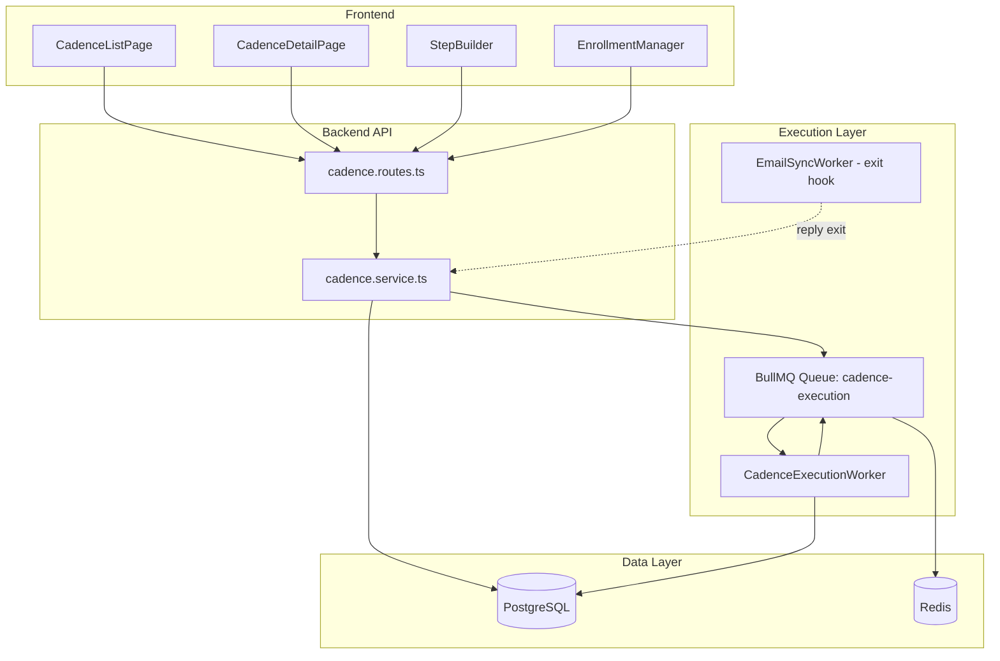
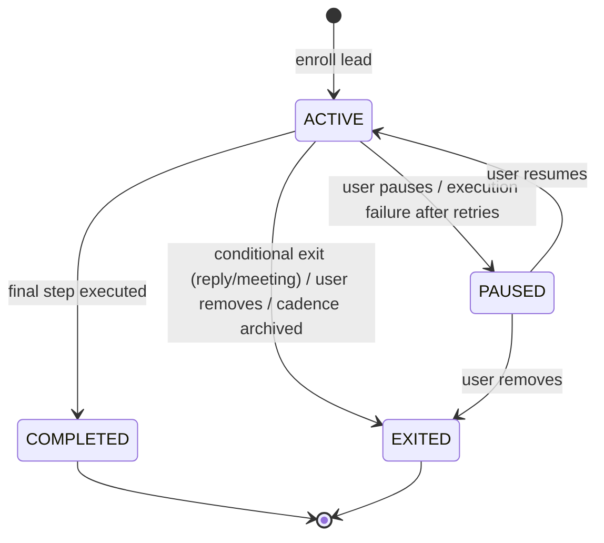
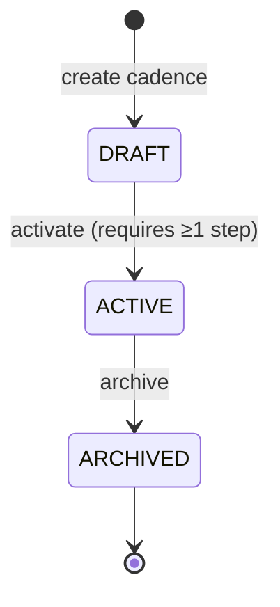
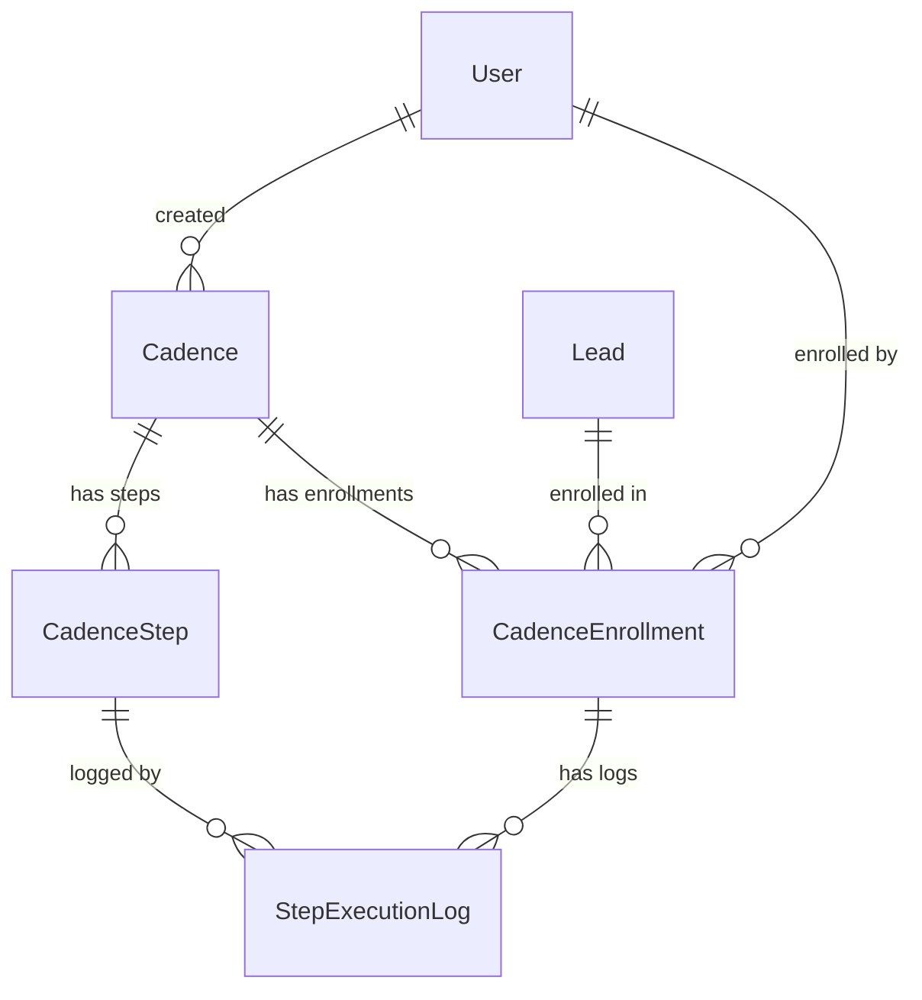

# Cadence Builder — Technical Design

## Overview

The Cadence Builder adds a Salesloft-style outbound sales sequence engine to the CRM. A **cadence** is a reusable template of ordered steps (email, call, LinkedIn, manual task) with configurable delays. Leads are **enrolled** into active cadences, and a BullMQ-based **execution engine** processes due steps on schedule — auto-sending emails, creating tasks for manual actions, and logging activities. Conditional exits (reply detected, meeting booked) automatically remove leads from sequences. Analytics surfaces enrollment counts, completion rates, and per-step metrics.

The feature spans the full stack:
- **Prisma schema** additions: `Cadence`, `CadenceStep`, `CadenceEnrollment`, `StepExecutionLog` models with new enums
- **Backend module**: `packages/backend/src/modules/cadences/` following existing route/service/index pattern
- **BullMQ jobs**: `cadence-execution` queue with delayed jobs for step scheduling, plus event listeners for conditional exits
- **Frontend**: new pages and components under `packages/frontend/src/pages/` and `packages/frontend/src/components/cadences/`

### Key Design Decisions

1. **One queue, job-per-step**: Each enrollment step gets its own delayed BullMQ job rather than a polling approach. This gives precise timing, natural retry semantics, and scales to thousands of concurrent enrollments.
2. **Enrollment as state machine**: `CadenceEnrollment` tracks `status` (ACTIVE → PAUSED/COMPLETED/EXITED) and `currentStepOrder` to know exactly where each lead is.
3. **Conditional exits via event hooks**: Reply detection piggybacks on the existing email sync worker; meeting detection hooks into the activity creation flow. Both check for active enrollments and trigger exits.
4. **Step immutability for active cadences with enrollments**: When a cadence is ACTIVE with enrollments, only appending new steps is allowed — no reordering or deletion — to avoid corrupting in-flight enrollment positions.

## Architecture

### System Architecture Diagram



### Enrollment State Machine



### Cadence Lifecycle



## Components and Interfaces

### Backend Module Structure

```
packages/backend/src/modules/cadences/
├── cadence.routes.ts      # Fastify route definitions
├── cadence.service.ts     # Business logic
├── cadence.types.ts       # Input/output type definitions
├── index.ts               # Barrel export
└── __tests__/
    ├── cadence.test.ts
    └── cadence.property.test.ts
```

### API Endpoints

#### Cadence CRUD

| Method | Path | Auth | Description |
|--------|------|------|-------------|
| POST | `/api/v1/cadences` | ADMIN, MANAGER | Create cadence (DRAFT) |
| GET | `/api/v1/cadences` | All authenticated | List cadences with metrics |
| GET | `/api/v1/cadences/:id` | All authenticated | Get cadence detail with steps & metrics |
| PUT | `/api/v1/cadences/:id` | ADMIN, MANAGER | Update cadence name/status |
| DELETE | `/api/v1/cadences/:id` | ADMIN, MANAGER | Delete cadence (no active enrollments) |

#### Step Management

| Method | Path | Auth | Description |
|--------|------|------|-------------|
| POST | `/api/v1/cadences/:id/steps` | ADMIN, MANAGER | Add step |
| PUT | `/api/v1/cadences/:cadenceId/steps/:stepId` | ADMIN, MANAGER | Update step |
| DELETE | `/api/v1/cadences/:cadenceId/steps/:stepId` | ADMIN, MANAGER | Remove step |
| PUT | `/api/v1/cadences/:id/steps/reorder` | ADMIN, MANAGER | Reorder steps |

#### Enrollment Management

| Method | Path | Auth | Description |
|--------|------|------|-------------|
| POST | `/api/v1/cadences/:id/enrollments` | All authenticated | Enroll lead(s) |
| GET | `/api/v1/cadences/:id/enrollments` | All authenticated | List enrollments for cadence |
| PUT | `/api/v1/enrollments/:id/pause` | All authenticated | Pause enrollment |
| PUT | `/api/v1/enrollments/:id/resume` | All authenticated | Resume enrollment |
| DELETE | `/api/v1/enrollments/:id` | All authenticated | Remove lead from cadence |

#### Analytics

| Method | Path | Auth | Description |
|--------|------|------|-------------|
| GET | `/api/v1/cadences/:id/analytics` | All authenticated | Get cadence analytics |

### Service Interface (cadence.service.ts)

```typescript
class CadenceService {
  // Cadence CRUD
  async createCadence(input: CreateCadenceInput, userId: string): Promise<Cadence>
  async listCadences(): Promise<CadenceWithMetrics[]>
  async getCadenceById(id: string): Promise<CadenceDetail>
  async updateCadence(id: string, input: UpdateCadenceInput): Promise<Cadence>
  async deleteCadence(id: string): Promise<void>

  // Step management
  async addStep(cadenceId: string, input: CreateStepInput): Promise<CadenceStep>
  async updateStep(cadenceId: string, stepId: string, input: UpdateStepInput): Promise<CadenceStep>
  async removeStep(cadenceId: string, stepId: string): Promise<void>
  async reorderSteps(cadenceId: string, stepOrders: ReorderStepInput[]): Promise<CadenceStep[]>

  // Enrollment
  async enrollLead(cadenceId: string, input: EnrollLeadInput, userId: string): Promise<CadenceEnrollment>
  async bulkEnroll(cadenceId: string, input: BulkEnrollInput, userId: string): Promise<CadenceEnrollment[]>
  async pauseEnrollment(enrollmentId: string, userId: string): Promise<CadenceEnrollment>
  async resumeEnrollment(enrollmentId: string, userId: string): Promise<CadenceEnrollment>
  async exitEnrollment(enrollmentId: string, userId: string): Promise<CadenceEnrollment>
  async listEnrollments(cadenceId: string): Promise<EnrollmentWithLead[]>

  // Conditional exits
  async handleReplyDetected(leadId: string, contactEmail: string): Promise<void>
  async handleMeetingBooked(leadId: string): Promise<void>

  // Analytics
  async getCadenceAnalytics(cadenceId: string): Promise<CadenceAnalytics>

  // Internal — called by worker
  async executeStep(enrollmentId: string, stepId: string): Promise<void>
}
```

### BullMQ Job Structure

```typescript
// Queue name addition to QueueName enum
const QueueName = {
  // ... existing
  CADENCE_EXECUTION: 'cadence-execution',
} as const;

// Job data shape
interface CadenceStepJobData {
  enrollmentId: string;
  stepId: string;
  cadenceId: string;
  leadId: string;
  actionType: 'EMAIL' | 'CALL' | 'LINKEDIN' | 'MANUAL_TASK';
}

// Job options for cadence execution
const CadenceQueueDefaults = {
  attempts: 3,
  backoff: { type: 'exponential', delay: 5000 },
  removeOnComplete: { count: 500 },
  removeOnFail: { count: 1000 },
};
```

### Worker (cadenceExecution.ts)

```typescript
// packages/backend/src/jobs/cadenceExecution.ts
export function createCadenceExecutionWorker(): Worker {
  return new Worker(
    QueueName.CADENCE_EXECUTION,
    async (job: Job<CadenceStepJobData>) => {
      const cadenceService = new CadenceService();
      // 1. Check for conditional exits before executing
      // 2. Verify enrollment is still ACTIVE
      // 3. Execute the step action (send email / create task)
      // 4. Log execution in StepExecutionLog
      // 5. Advance enrollment to next step or mark COMPLETED
      // 6. Schedule next delayed job if more steps remain
      await cadenceService.executeStep(job.data.enrollmentId, job.data.stepId);
    },
    { connection: getRedisConnectionConfig(), concurrency: 10 }
  );
}
```

### Frontend Component Hierarchy

```
packages/frontend/src/
├── pages/
│   ├── CadencesPage.tsx           # List page (route: /cadences)
│   └── CadenceDetailPage.tsx      # Detail with tabs (route: /cadences/:id)
└── components/cadences/
    ├── CadenceList.tsx            # Table with search/sort/metrics
    ├── CadenceForm.tsx            # Create/edit cadence name modal
    ├── CadenceStatusBadge.tsx     # DRAFT/ACTIVE/ARCHIVED badge
    ├── StepTimeline.tsx           # Vertical timeline of steps
    ├── StepEditor.tsx             # Inline step editor panel
    ├── StepCard.tsx               # Single step in timeline
    ├── EnrollmentTable.tsx        # Enrollments tab content
    ├── EnrollLeadDialog.tsx       # Enroll lead(s) dialog
    ├── AnalyticsPanel.tsx         # Analytics tab content
    └── StepMetricsBar.tsx         # Per-step metric visualization
```

### Frontend Route Additions

```typescript
// In App.tsx, inside the authenticated Shell routes:
<Route path="/cadences" element={<CadencesPage />} />
<Route path="/cadences/:id" element={<CadenceDetailPage />} />
```

### Sidebar Navigation Addition

Add between "Tasks" and "CSV Import/Export":
```typescript
{ to: "/cadences", label: "Cadences", icon: Zap }  // Lucide Zap icon
```


## Data Models

### New Prisma Enums

```prisma
enum CadenceStatus {
  DRAFT
  ACTIVE
  ARCHIVED
}

enum ActionType {
  EMAIL
  CALL
  LINKEDIN
  MANUAL_TASK
}

enum EnrollmentStatus {
  ACTIVE
  PAUSED
  COMPLETED
  EXITED
}
```

### New Prisma Models

```prisma
model Cadence {
  id          String         @id @default(uuid())
  name        String
  status      CadenceStatus  @default(DRAFT)
  createdById String
  createdBy   User           @relation("cadencesCreated", fields: [createdById], references: [id])
  steps       CadenceStep[]
  enrollments CadenceEnrollment[]
  createdAt   DateTime       @default(now())
  updatedAt   DateTime       @updatedAt

  @@index([status])
  @@index([createdById])
}

model CadenceStep {
  id            String     @id @default(uuid())
  cadenceId     String
  cadence       Cadence    @relation(fields: [cadenceId], references: [id], onDelete: Cascade)
  stepOrder     Int
  actionType    ActionType
  delayHours    Int        @default(0)
  emailSubject  String?
  emailBody     String?
  taskTitle     String?
  taskDescription String?
  createdAt     DateTime   @default(now())
  updatedAt     DateTime   @updatedAt
  executionLogs StepExecutionLog[]

  @@unique([cadenceId, stepOrder])
  @@index([cadenceId])
}

model CadenceEnrollment {
  id               String           @id @default(uuid())
  cadenceId        String
  cadence          Cadence          @relation(fields: [cadenceId], references: [id])
  leadId           String
  lead             Lead             @relation(fields: [leadId], references: [id])
  enrolledById     String
  enrolledBy       User             @relation("enrollmentsCreated", fields: [enrolledById], references: [id])
  status           EnrollmentStatus @default(ACTIVE)
  currentStepOrder Int              @default(1)
  exitReason       String?          // "reply_detected", "meeting_booked", "manual", "cadence_archived"
  enrolledAt       DateTime         @default(now())
  completedAt      DateTime?
  updatedAt        DateTime         @updatedAt
  executionLogs    StepExecutionLog[]

  @@unique([cadenceId, leadId, status]) // prevent duplicate active enrollments
  @@index([cadenceId, status])
  @@index([leadId])
  @@index([enrolledById])
}

model StepExecutionLog {
  id           String           @id @default(uuid())
  enrollmentId String
  enrollment   CadenceEnrollment @relation(fields: [enrollmentId], references: [id])
  stepId       String
  step         CadenceStep      @relation(fields: [stepId], references: [id])
  actionType   ActionType
  outcome      String           // "success", "failure", "reply_detected", "meeting_booked"
  errorMessage String?
  executedAt   DateTime         @default(now())

  @@index([enrollmentId])
  @@index([stepId])
}
```

### User Model Additions

```prisma
model User {
  // ... existing fields
  cadencesCreated    Cadence[]           @relation("cadencesCreated")
  enrollmentsCreated CadenceEnrollment[] @relation("enrollmentsCreated")
}
```

### Lead Model Addition

```prisma
model Lead {
  // ... existing fields
  cadenceEnrollments CadenceEnrollment[]
}
```

### Entity Relationship Diagram



### Key Indexes and Constraints

- `CadenceStep(cadenceId, stepOrder)` — unique composite ensures no duplicate step positions within a cadence
- `CadenceEnrollment(cadenceId, leadId, status)` — unique composite prevents duplicate active enrollments (a lead can re-enroll after EXITED/COMPLETED)
- `CadenceEnrollment(cadenceId, status)` — fast lookup for active enrollments per cadence
- `StepExecutionLog(enrollmentId)` — fast log retrieval per enrollment

### Step Execution Algorithm

```
executeStep(enrollmentId, stepId):
  1. Load enrollment with cadence and step
  2. If enrollment.status ≠ ACTIVE → skip (job is stale)
  3. Check conditional exits:
     a. Query recent inbound emails from lead's contacts
     b. Query recent MEETING activities on lead
     c. If exit condition met → set EXITED, cancel jobs, log, return
  4. Execute action based on step.actionType:
     - EMAIL: send via enrolledBy user's EmailAccount
     - CALL/LINKEDIN/MANUAL_TASK: create Task
  5. Create Activity on lead
  6. Create StepExecutionLog with outcome "success"
  7. If more steps remain:
     a. Advance enrollment.currentStepOrder
     b. Schedule next job with delay = nextStep.delayHours * 3600 * 1000 ms
  8. If no more steps:
     a. Set enrollment.status = COMPLETED, set completedAt
```

### Conditional Exit Integration Points

1. **Reply detection**: In the existing `emailSync.ts` worker, after syncing inbound emails, call `cadenceService.handleReplyDetected(leadId, fromEmail)` for each inbound message. This checks if the lead has an active enrollment and triggers exit.

2. **Meeting booked**: In the activity creation flow (`activity.service.ts`), after creating a MEETING activity, call `cadenceService.handleMeetingBooked(leadId)`.

### Analytics Query Strategy

Analytics are computed on-demand (not materialized) using aggregate queries:

```sql
-- Per-cadence metrics
SELECT
  status,
  COUNT(*) as count
FROM "CadenceEnrollment"
WHERE "cadenceId" = $1
GROUP BY status;

-- Completion rate
SELECT
  COUNT(*) FILTER (WHERE status = 'COMPLETED') * 100.0 / NULLIF(COUNT(*), 0) as completion_rate
FROM "CadenceEnrollment"
WHERE "cadenceId" = $1;

-- Average time to completion
SELECT AVG(EXTRACT(EPOCH FROM ("completedAt" - "enrolledAt"))) as avg_seconds
FROM "CadenceEnrollment"
WHERE "cadenceId" = $1 AND status = 'COMPLETED';

-- Per-step metrics
SELECT
  cs."stepOrder",
  COUNT(sel.id) FILTER (WHERE sel.outcome = 'success') as completed,
  COUNT(DISTINCT ce.id) FILTER (WHERE ce."currentStepOrder" >= cs."stepOrder") as reached,
  COUNT(sel.id) FILTER (WHERE sel.outcome IN ('reply_detected', 'meeting_booked')) as exited
FROM "CadenceStep" cs
LEFT JOIN "StepExecutionLog" sel ON sel."stepId" = cs.id
LEFT JOIN "CadenceEnrollment" ce ON ce.id = sel."enrollmentId"
WHERE cs."cadenceId" = $1
GROUP BY cs."stepOrder"
ORDER BY cs."stepOrder";
```


## Correctness Properties

*A property is a characteristic or behavior that should hold true across all valid executions of a system — essentially, a formal statement about what the system should do. Properties serve as the bridge between human-readable specifications and machine-verifiable correctness guarantees.*

### Property 1: Cadence creation defaults to DRAFT

*For any* valid non-empty cadence name, creating a cadence should produce a cadence with status `DRAFT`, the given name, and a valid UUID id.

**Validates: Requirements 1.1**

### Property 2: Cadence list ordering

*For any* set of cadences in the database, listing cadences should return them ordered by `createdAt` descending — that is, for every adjacent pair in the result, the earlier element has a `createdAt` >= the later element's `createdAt`.

**Validates: Requirements 1.2**

### Property 3: Cadence update round-trip

*For any* existing cadence and any valid update input (non-empty name or valid status transition), updating the cadence and then reading it back should reflect the updated values.

**Validates: Requirements 1.3**

### Property 4: Deletion blocked by active enrollments

*For any* cadence, deletion succeeds if and only if the cadence has zero enrollments with status `ACTIVE`. If active enrollments exist, deletion must be rejected with an error.

**Validates: Requirements 1.4, 1.5**

### Property 5: Activation requires at least one step

*For any* cadence in DRAFT status, transitioning to ACTIVE succeeds if and only if the cadence has at least one CadenceStep. A cadence with zero steps must be rejected.

**Validates: Requirements 1.6**

### Property 6: Archiving exits all active enrollments

*For any* cadence with N active enrollments (N ≥ 0), archiving the cadence should result in all N enrollments having status `EXITED` with exitReason `"cadence_archived"`.

**Validates: Requirements 1.7**

### Property 7: RBAC mutation rejection

*For any* user with role `TEAM_MEMBER`, any attempt to create, update, or delete a cadence or cadence step via the API should be rejected with a 403 status code. The cadence/step data must remain unchanged.

**Validates: Requirements 1.9, 9.5**

### Property 8: Step validation

*For any* step creation input, the step is accepted if and only if it has a valid `actionType` (one of EMAIL, CALL, LINKEDIN, MANUAL_TASK) and a `delayHours` value ≥ 0. Invalid inputs must be rejected.

**Validates: Requirements 2.1**

### Property 9: Step removal re-numbers contiguously

*For any* cadence with N steps (N ≥ 2) and any step position K (1 ≤ K ≤ N), removing step K should result in exactly N-1 steps with `stepOrder` values forming a contiguous sequence from 1 to N-1, and the set of remaining step IDs should equal the original set minus the removed step's ID.

**Validates: Requirements 2.4**

### Property 10: Step reorder preserves set and persists order

*For any* cadence and any valid permutation of its steps, reordering should result in the exact same set of step IDs (no additions or removals), and reading the steps back should reflect the new order.

**Validates: Requirements 2.5, 2.6**

### Property 11: Archived cadence rejects step modifications

*For any* cadence in ARCHIVED status, any attempt to add, remove, update, or reorder steps should be rejected with an error.

**Validates: Requirements 2.7**

### Property 12: Active cadence with enrollments restricts step mutations

*For any* cadence in ACTIVE status that has at least one active enrollment, adding a step should only succeed if the new step's `stepOrder` is greater than all existing step orders (append only). Removing or reordering existing steps should be rejected.

**Validates: Requirements 2.8**

### Property 13: Enrollment initialization

*For any* lead and any ACTIVE cadence, enrolling the lead should produce an enrollment with status `ACTIVE`, `currentStepOrder` = 1, and the correct `cadenceId` and `leadId`.

**Validates: Requirements 3.1**

### Property 14: Duplicate active enrollment rejection

*For any* lead that already has an enrollment with status `ACTIVE` in a given cadence, a second enrollment attempt for the same lead and cadence should be rejected.

**Validates: Requirements 3.2**

### Property 15: TEAM_MEMBER lead assignment enforcement

*For any* user with role `TEAM_MEMBER` and any lead not assigned to that user, enrollment, pause, resume, and exit operations should be rejected. For leads assigned to the user, these operations should succeed (given other preconditions are met).

**Validates: Requirements 3.3, 9.3, 9.4**

### Property 16: Enrollment status transitions — pause

*For any* enrollment with status `ACTIVE`, pausing should set the status to `PAUSED`. Pausing an enrollment that is not `ACTIVE` should be rejected.

**Validates: Requirements 3.6**

### Property 17: Enrollment status transitions — resume

*For any* enrollment with status `PAUSED`, resuming should set the status to `ACTIVE`. Resuming an enrollment that is not `PAUSED` should be rejected.

**Validates: Requirements 3.7**

### Property 18: Enrollment status transitions — exit

*For any* enrollment with status `ACTIVE` or `PAUSED`, manual removal should set the status to `EXITED`. Removing an enrollment that is already `COMPLETED` or `EXITED` should be rejected.

**Validates: Requirements 3.8**

### Property 19: Bulk enrollment count

*For any* set of N distinct leads (each valid for enrollment) and an ACTIVE cadence, bulk enrollment should create exactly N enrollments, each with status `ACTIVE`.

**Validates: Requirements 3.9**

### Property 20: Non-ACTIVE cadence rejects enrollment

*For any* cadence with status `DRAFT` or `ARCHIVED`, any enrollment attempt should be rejected with an error.

**Validates: Requirements 3.10**

### Property 21: Step execution creates log

*For any* step execution (success or failure), a `StepExecutionLog` entry should be created with the correct `enrollmentId`, `stepId`, `actionType`, and a non-null `executedAt` timestamp.

**Validates: Requirements 4.2**

### Property 22: Step advancement

*For any* enrollment at step N where the cadence has M total steps (N < M), successful step execution should advance `currentStepOrder` to N+1.

**Validates: Requirements 4.3**

### Property 23: Final step completes enrollment

*For any* enrollment at the last step of its cadence, successful step execution should set the enrollment status to `COMPLETED` and set `completedAt` to a non-null timestamp.

**Validates: Requirements 4.4**

### Property 24: Exhausted retries pause enrollment

*For any* enrollment where step execution has failed after all retry attempts, the enrollment status should be set to `PAUSED` and a Task should be created assigned to the lead's assigned user.

**Validates: Requirements 4.6**

### Property 25: Paused enrollment skips execution

*For any* enrollment with status `PAUSED`, attempting to execute a step should be a no-op — no log entry created, no state change, no side effects.

**Validates: Requirements 4.7**

### Property 26: EMAIL step sends to correct recipient

*For any* EMAIL step execution where the enrolling user has a connected EmailAccount, the email should be addressed to the lead's primary contact email, use the step's subject and body template, and be sent from the enrolling user's email account.

**Validates: Requirements 5.1**

### Property 27: Non-EMAIL step creates correctly titled task

*For any* step with actionType CALL, LINKEDIN, or MANUAL_TASK, execution should create a Task where: for CALL the title is `"Call: {lead name}"`, for LINKEDIN the title is `"LinkedIn: {lead name}"`, and for MANUAL_TASK the title and description match the step's configured values. The task should be assigned to the lead's assigned user with dueDate set to the current timestamp.

**Validates: Requirements 5.2, 5.3, 5.4**

### Property 28: Step execution creates activity

*For any* step execution, an Activity record should be created on the lead with the appropriate ActivityType: `EMAIL` for email steps, `CALL` for call steps, `NOTE` for LinkedIn and manual task steps.

**Validates: Requirements 5.5**

### Property 29: Conditional exit on qualifying event

*For any* active enrollment, when a qualifying exit event occurs (inbound email from the lead's contact, or a MEETING activity logged on the lead), the enrollment status should be set to `EXITED`, the `exitReason` should be set to the appropriate value (`"reply_detected"` or `"meeting_booked"`), and a StepExecutionLog should be created with the matching outcome.

**Validates: Requirements 6.1, 6.2**

### Property 30: Conditional exit checked before step execution

*For any* enrollment with a pending conditional exit condition (reply received or meeting booked since the job was scheduled), step execution should detect the exit condition and not execute the step action.

**Validates: Requirements 6.4**

### Property 31: Cadence-level analytics correctness

*For any* cadence with a known set of enrollments with known statuses and timestamps, the analytics computation should return: total = count of all enrollments, active/completed/exited counts matching the actual status distribution, completion_rate = completed/total * 100, and average completion time = mean of (completedAt - enrolledAt) for completed enrollments.

**Validates: Requirements 7.1, 7.3**

### Property 32: Per-step analytics correctness

*For any* cadence with known step execution logs, the per-step metrics should correctly report: the number of enrollments that reached each step, the number that completed each step, and the number that exited at each step.

**Validates: Requirements 7.2**

## Error Handling

The cadence module follows the existing `AppError` pattern with `ErrorCode` enum:

| Scenario | ErrorCode | HTTP Status | Message |
|----------|-----------|-------------|---------|
| Empty cadence name | `VALIDATION_ERROR` | 400 | "Cadence name is required" |
| Invalid ActionType | `VALIDATION_ERROR` | 400 | "Invalid action type" |
| Negative delay | `VALIDATION_ERROR` | 400 | "Delay must be >= 0 hours" |
| Activate cadence with 0 steps | `VALIDATION_ERROR` | 400 | "Cadence must have at least one step to activate" |
| Delete cadence with active enrollments | `VALIDATION_ERROR` | 400 | "Cannot delete cadence with active enrollments" |
| Modify archived cadence steps | `VALIDATION_ERROR` | 400 | "Cannot modify steps of an archived cadence" |
| Remove/reorder steps on active cadence with enrollments | `VALIDATION_ERROR` | 400 | "Cannot remove or reorder steps while enrollments are active" |
| Cadence not found | `NOT_FOUND` | 404 | "Cadence not found" |
| Step not found | `NOT_FOUND` | 404 | "Step not found" |
| Enrollment not found | `NOT_FOUND` | 404 | "Enrollment not found" |
| TEAM_MEMBER mutates cadence/step | `ACCESS_DENIED` | 403 | "Access denied" |
| TEAM_MEMBER operates on unassigned lead | `ACCESS_DENIED` | 403 | "Access denied" |
| Duplicate active enrollment | `DUPLICATE_DETECTED` | 409 | "Lead is already actively enrolled in this cadence" |
| Enroll into non-ACTIVE cadence | `VALIDATION_ERROR` | 400 | "Only active cadences accept enrollments" |
| Pause non-ACTIVE enrollment | `VALIDATION_ERROR` | 400 | "Only active enrollments can be paused" |
| Resume non-PAUSED enrollment | `VALIDATION_ERROR` | 400 | "Only paused enrollments can be resumed" |
| No email account for EMAIL step | `VALIDATION_ERROR` | 400 | "No connected email account" |

### Worker Error Handling

The cadence execution worker uses BullMQ's built-in retry mechanism:
- 3 attempts with exponential backoff (5s, 10s, 20s)
- On final failure: enrollment set to PAUSED, notification Task created
- All failures logged in `StepExecutionLog` with outcome `"failure"` and `errorMessage`

### Stale Job Handling

Before executing any step, the worker validates:
1. Enrollment still exists and is ACTIVE
2. No conditional exit events have occurred since scheduling
3. The step matches the enrollment's current step

If any check fails, the job completes without side effects (idempotent skip).

## Testing Strategy

### Unit Tests

Unit tests cover specific examples, edge cases, and integration points:

- Cadence CRUD: create with valid/invalid names, status transitions (DRAFT→ACTIVE→ARCHIVED), delete with/without enrollments
- Step management: add/remove/reorder steps, re-numbering after removal, archived cadence rejection
- Enrollment: enroll/pause/resume/exit, duplicate rejection, RBAC enforcement for TEAM_MEMBER
- Action execution: email sending (mocked), task creation for CALL/LINKEDIN/MANUAL_TASK
- Conditional exits: reply detection, meeting booked detection
- Analytics: known data sets with expected metric outputs
- Error cases: all error scenarios from the Error Handling table

### Property-Based Tests

Property-based tests use `fast-check` (the standard PBT library for TypeScript/JavaScript) with minimum 100 iterations per property.

Each property test references its design document property with a tag comment:

```typescript
// Feature: cadence-builder, Property 1: Cadence creation defaults to DRAFT
```

Properties to implement as PBT:

1. **Property 1**: Cadence creation defaults to DRAFT — generate random valid names, verify DRAFT status
2. **Property 2**: Cadence list ordering — generate random cadences, verify descending createdAt order
3. **Property 4**: Deletion blocked by active enrollments — generate cadences with/without enrollments, verify deletion behavior
4. **Property 5**: Activation requires at least one step — generate cadences with 0..N steps, verify activation
5. **Property 6**: Archiving exits all active enrollments — generate cadences with random enrollments, verify all become EXITED
6. **Property 7**: RBAC mutation rejection — generate random mutation operations with TEAM_MEMBER user, verify 403
7. **Property 8**: Step validation — generate random actionType/delay combinations, verify acceptance/rejection
8. **Property 9**: Step removal re-numbers contiguously — generate cadences with N steps, remove random step, verify contiguous 1..N-1
9. **Property 10**: Step reorder preserves set and persists order — generate random permutations, verify set equality and order persistence
10. **Property 13**: Enrollment initialization — generate random leads and cadences, verify ACTIVE status and currentStepOrder=1
11. **Property 14**: Duplicate active enrollment rejection — generate duplicate enrollment attempts, verify rejection
12. **Property 15**: TEAM_MEMBER lead assignment enforcement — generate TEAM_MEMBER users with assigned/unassigned leads, verify access control
13. **Property 16-18**: Enrollment state transitions — generate enrollments in various states, verify valid/invalid transitions
14. **Property 19**: Bulk enrollment count — generate random lead sets, verify enrollment count matches
15. **Property 21**: Step execution creates log — generate random step executions, verify log creation
16. **Property 22-23**: Step advancement and completion — generate enrollments at various positions, verify advancement/completion
17. **Property 27**: Non-EMAIL step task creation — generate random CALL/LINKEDIN/MANUAL_TASK steps with random lead names, verify task title format
18. **Property 29**: Conditional exit on qualifying event — generate active enrollments with exit events, verify EXITED status and reason
19. **Property 31**: Cadence-level analytics — generate random enrollment distributions, verify metric computation
20. **Property 32**: Per-step analytics — generate random execution logs, verify per-step metric computation

### Test Configuration

```typescript
import fc from 'fast-check';

// All property tests run with minimum 100 iterations
const PBT_NUM_RUNS = 100;

fc.assert(
  fc.property(
    fc.string({ minLength: 1 }),
    (name) => { /* property assertion */ }
  ),
  { numRuns: PBT_NUM_RUNS }
);
```

### Test File Structure

```
packages/backend/src/modules/cadences/__tests__/
├── cadence.test.ts                    # Unit tests
├── cadence-crud.property.test.ts      # Properties 1-7
├── cadence-steps.property.test.ts     # Properties 8-12
├── cadence-enrollment.property.test.ts # Properties 13-20
├── cadence-execution.property.test.ts  # Properties 21-30
└── cadence-analytics.property.test.ts  # Properties 31-32
```
