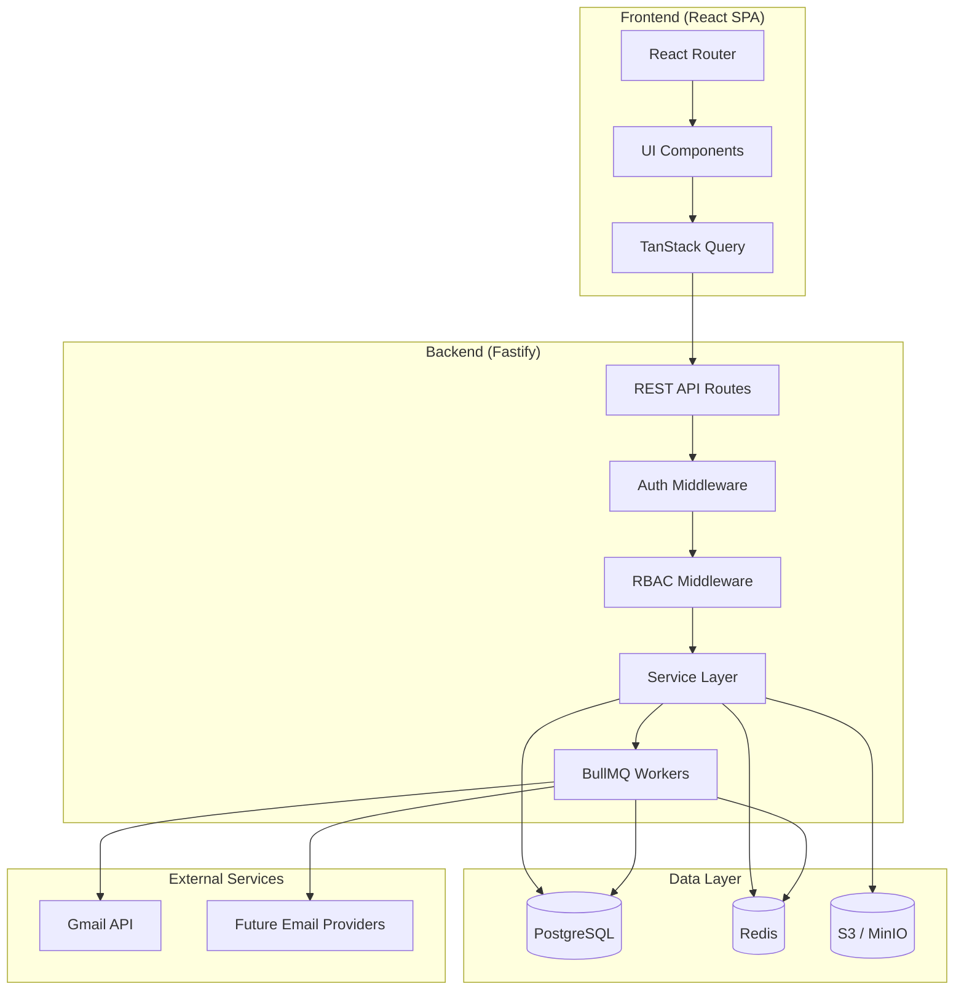
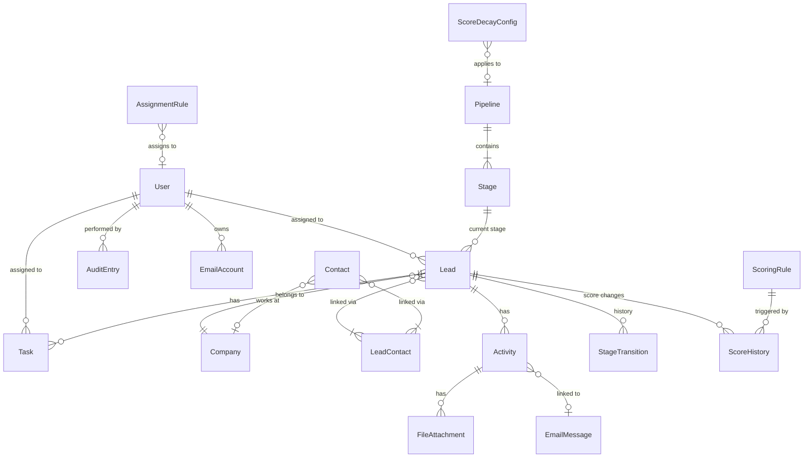

# Design Document: Lead Management System

## Overview

The Lead Management System is a full-stack web application for tracking sales leads through customizable pipelines, managing contacts and companies, logging activities, scoring leads, and providing reporting dashboards. It integrates with external email providers (starting with Gmail), supports CSV import/export with field mapping, enforces role-based access control, detects duplicate leads, auto-assigns leads via configurable rules, maintains a comprehensive audit log, and provides full-text search with filtering.

### Tech Stack

- **Frontend**: React 18+ with TypeScript, Tailwind CSS, Shadcn/ui component library, TanStack Query for server state
- **Backend**: Node.js with Fastify + TypeScript
- **Database**: PostgreSQL 15+
- **ORM**: Prisma
- **Cache / Queues**: Redis + BullMQ for background jobs (email sync, score decay, reminders)
- **Auth**: Passport.js with OAuth 2.0 (Gmail), JWT session tokens
- **Email**: Nodemailer + Gmail API via a provider-agnostic adapter interface
- **Search**: PostgreSQL full-text search (tsvector/tsquery) with GIN indexes
- **File Storage**: S3-compatible object storage (e.g., MinIO locally, AWS S3 in production)
- **Testing**: Vitest + fast-check for property-based testing

## Architecture

The system follows a layered architecture with clear separation between the API layer, business logic, and data access.



### Key Architectural Decisions

1. **Fastify over Express**: Fastify provides built-in schema validation, better performance, and first-class TypeScript support. Its plugin system maps well to our modular domain structure.

2. **PostgreSQL full-text search over Elasticsearch**: For datasets up to 100K records (Requirement 13.2), PostgreSQL's tsvector/tsquery with GIN indexes meets the 500ms SLA without introducing an additional infrastructure dependency.

3. **BullMQ for background jobs**: Email sync, score decay evaluation, and task reminders all require reliable background processing. BullMQ on Redis provides job scheduling, retries, and cron-like recurring jobs.

4. **S3-compatible storage for file attachments**: Activity file attachments (up to 25MB per file, Requirement 4.8) are stored in S3 with metadata in PostgreSQL. This keeps the database lean and allows presigned URL downloads.

5. **Provider-agnostic email interface**: The email integration uses an adapter pattern (Requirement 3.2) so new providers can be added by implementing a standard interface without touching sync or logging logic.

6. **JWT + refresh tokens for auth**: Stateless JWT access tokens (short-lived) with Redis-backed refresh tokens. OAuth 2.0 tokens for Gmail are stored encrypted in the database.

## Components and Interfaces

### Backend Modules

```
src/
├── modules/
│   ├── auth/           # Authentication, OAuth, JWT
│   ├── leads/          # Lead CRUD, pipeline, stage transitions
│   ├── contacts/       # Contact CRUD, company association
│   ├── companies/      # Company CRUD
│   ├── activities/     # Activity logging, timeline
│   ├── tasks/          # Task CRUD, reminders
│   ├── scoring/        # Lead scoring, rules, decay
│   ├── dashboard/      # Reporting queries, aggregations
│   ├── csv/            # Import/export, field mapping
│   ├── rbac/           # Role checks, permission middleware
│   ├── duplicates/     # Duplicate detection logic
│   ├── assignments/    # Assignment rules engine
│   ├── audit/          # Audit log recording and querying
│   ├── search/         # Full-text search, filtering
│   ├── email/          # Email provider adapters, sync
│   └── files/          # File upload/download, S3 integration
├── common/
│   ├── middleware/      # Auth, RBAC, error handling, request logging
│   ├── utils/          # Shared helpers
│   └── types/          # Shared TypeScript types
├── jobs/               # BullMQ worker definitions
│   ├── emailSync.ts
│   ├── scoreDecay.ts
│   └── taskReminder.ts
├── db/
│   └── prisma/         # Prisma schema, migrations
└── app.ts              # Fastify app bootstrap
```

### Key Interfaces

#### Email Provider Adapter (Requirement 3.2, 3.9)

```typescript
interface EmailProviderAdapter {
  readonly providerName: string;
  authenticate(credentials: OAuthCredentials): Promise<AuthResult>;
  refreshToken(refreshToken: string): Promise<AuthResult>;
  syncEmails(account: EmailAccount, since: Date): Promise<EmailMessage[]>;
  sendEmail(account: EmailAccount, message: OutgoingEmail): Promise<SendResult>;
  validateConfiguration(): Promise<boolean>;
}
```

New providers implement this interface. The `EmailProviderRegistry` validates implementations at registration time (Requirement 3.9).

#### Assignment Engine (Requirement 11)

```typescript
interface AssignmentRule {
  id: string;
  type: 'territory' | 'deal_size' | 'round_robin';
  priority: number;
  config: TerritoryConfig | DealSizeConfig | RoundRobinConfig;
  isActive: boolean;
}

interface AssignmentEngine {
  evaluate(lead: Lead, rules: AssignmentRule[]): Promise<AssignmentResult>;
}
```

Rules are evaluated in priority order. The first matching rule determines assignment. If none match, the lead stays unassigned and managers are notified (Requirement 11.5).

#### Scoring Engine (Requirement 6)

```typescript
interface ScoringRule {
  id: string;
  type: 'activity_count' | 'deal_value' | 'stage_progression' | 'email_engagement';
  points: number;
  config: Record<string, unknown>;
}

interface ScoringEngine {
  calculate(lead: Lead, rules: ScoringRule[]): number; // Returns 0-100
  applyDecay(leads: Lead[], decayRule: ScoreDecayRule): DecayResult[];
}
```

Score is clamped to [0, 100]. Decay is evaluated daily via a BullMQ cron job.

#### Duplicate Detector (Requirement 10)

```typescript
interface DuplicateDetector {
  check(contactEmail?: string, companyName?: string): Promise<DuplicateMatch[]>;
  merge(sourceLeadId: string, targetLeadId: string): Promise<Lead>;
}
```

Matching is case-insensitive (Requirement 10.7). Merge combines activities and contacts from both leads.

### Frontend Structure

```
src/
├── components/
│   ├── layout/          # Shell, sidebar, header
│   ├── pipeline/        # Kanban board, stage columns
│   ├── leads/           # Lead forms, detail view
│   ├── contacts/        # Contact forms, list
│   ├── companies/       # Company forms, list
│   ├── activities/      # Timeline, activity forms
│   ├── tasks/           # Task list, task forms
│   ├── scoring/         # Score display, rule config
│   ├── dashboard/       # Charts, metric cards
│   ├── csv/             # Import wizard, field mapping UI, export button
│   ├── search/          # Search bar, filter panel, results
│   ├── audit/           # Audit log table, filters
│   └── common/          # Shared UI components
├── hooks/               # Custom React hooks
├── api/                 # TanStack Query hooks, API client
├── types/               # Shared frontend types
├── utils/               # Helpers, formatters
└── App.tsx
```

### REST API Design

All endpoints are prefixed with `/api/v1`. Authentication is required unless noted.

#### Leads
| Method | Path | Description |
|--------|------|-------------|
| POST | /leads | Create a lead |
| GET | /leads | List leads (with filters, pagination) |
| GET | /leads/:id | Get lead detail |
| PUT | /leads/:id | Update lead |
| DELETE | /leads/:id | Delete lead |
| POST | /leads/:id/move | Move lead to a different stage |
| GET | /leads/:id/timeline | Get activity timeline |
| GET | /leads/:id/audit | Get audit entries for lead |

#### Pipelines & Stages
| Method | Path | Description |
|--------|------|-------------|
| POST | /pipelines | Create pipeline (min 2 stages) |
| GET | /pipelines | List pipelines |
| GET | /pipelines/:id | Get pipeline with stages |
| PUT | /pipelines/:id | Update pipeline |
| PUT | /pipelines/:id/stages/reorder | Reorder stages |

#### Contacts
| Method | Path | Description |
|--------|------|-------------|
| POST | /contacts | Create contact |
| GET | /contacts | List contacts |
| GET | /contacts/:id | Get contact detail |
| PUT | /contacts/:id | Update contact |
| DELETE | /contacts/:id | Delete contact |

#### Companies
| Method | Path | Description |
|--------|------|-------------|
| POST | /companies | Create company |
| GET | /companies | List companies |
| GET | /companies/:id | Get company with leads and contacts |
| PUT | /companies/:id | Update company |
| DELETE | /companies/:id | Delete company (with confirmation) |

#### Activities
| Method | Path | Description |
|--------|------|-------------|
| POST | /leads/:id/activities | Log activity on a lead |
| GET | /leads/:id/activities | List activities (filterable by type) |
| POST | /activities/:id/files | Attach file to activity |
| GET | /files/:id/download | Download/preview file |

#### Tasks
| Method | Path | Description |
|--------|------|-------------|
| POST | /tasks | Create task (linked to lead) |
| GET | /tasks | List tasks for current user |
| GET | /tasks/:id | Get task detail |
| PUT | /tasks/:id | Update task |
| PUT | /tasks/:id/complete | Mark task complete |
| PUT | /tasks/:id/reassign | Reassign task |

#### Scoring
| Method | Path | Description |
|--------|------|-------------|
| GET | /scoring/rules | List scoring rules |
| POST | /scoring/rules | Create scoring rule (Manager/Admin) |
| PUT | /scoring/rules/:id | Update scoring rule |
| DELETE | /scoring/rules/:id | Delete scoring rule |
| GET | /scoring/decay | Get decay configuration |
| PUT | /scoring/decay | Update decay configuration |
| GET | /leads/ranked | Get leads sorted by score |

#### Dashboard
| Method | Path | Description |
|--------|------|-------------|
| GET | /dashboard/pipeline-value | Pipeline value by stage |
| GET | /dashboard/conversion-rates | Stage-to-stage conversion rates |
| GET | /dashboard/stage-duration | Average stage duration |
| GET | /dashboard/lead-counts | Lead counts by stage |
| GET | /dashboard/closed-summary | Closed won/lost counts |

#### CSV
| Method | Path | Description |
|--------|------|-------------|
| POST | /csv/import/upload | Upload CSV, get column headers |
| POST | /csv/import/preview | Preview with field mapping |
| POST | /csv/import/execute | Execute import |
| GET | /csv/export | Export leads to CSV |
| GET | /csv/field-mappings | List saved field mappings |
| POST | /csv/field-mappings | Save field mapping |

#### Email
| Method | Path | Description |
|--------|------|-------------|
| POST | /email/connect | Initiate OAuth flow |
| GET | /email/callback | OAuth callback |
| POST | /email/sync | Trigger manual sync |
| POST | /leads/:id/email/send | Send email from lead view |

#### Users & RBAC
| Method | Path | Description |
|--------|------|-------------|
| GET | /users | List users (Admin) |
| PUT | /users/:id/role | Change user role (Admin) |
| GET | /me | Get current user profile |

#### Assignment Rules
| Method | Path | Description |
|--------|------|-------------|
| GET | /assignment-rules | List rules |
| POST | /assignment-rules | Create rule (Manager/Admin) |
| PUT | /assignment-rules/:id | Update rule |
| DELETE | /assignment-rules/:id | Delete rule |

#### Audit Log
| Method | Path | Description |
|--------|------|-------------|
| GET | /audit | Query audit log (Admin, filterable) |

#### Search
| Method | Path | Description |
|--------|------|-------------|
| GET | /search | Full-text search with filters |

## Data Models

### Entity Relationship Diagram



### Prisma Schema (Core Models)

```prisma
enum Role {
  TEAM_MEMBER
  MANAGER
  ADMIN
}

enum ActivityType {
  CALL
  MEETING
  NOTE
  EMAIL
  FILE_ATTACHMENT
}

enum TaskPriority {
  LOW
  MEDIUM
  HIGH
}

enum AssignmentRuleType {
  TERRITORY
  DEAL_SIZE
  ROUND_ROBIN
}

enum AuditAction {
  CREATE
  UPDATE
  DELETE
}

model User {
  id             String           @id @default(uuid())
  email          String           @unique
  name           String
  role           Role             @default(TEAM_MEMBER)
  createdAt      DateTime         @default(now())
  updatedAt      DateTime         @updatedAt
  assignedLeads  Lead[]
  tasks          Task[]
  auditEntries   AuditEntry[]
  emailAccounts  EmailAccount[]
}

model Pipeline {
  id          String   @id @default(uuid())
  name        String
  createdAt   DateTime @default(now())
  updatedAt   DateTime @updatedAt
  stages      Stage[]
}

model Stage {
  id          String   @id @default(uuid())
  name        String
  order       Int
  isClosedWon Boolean  @default(false)
  isClosedLost Boolean @default(false)
  pipelineId  String
  pipeline    Pipeline @relation(fields: [pipelineId], references: [id])
  leads       Lead[]
  createdAt   DateTime @default(now())

  @@unique([pipelineId, order])
}

model Lead {
  id              String            @id @default(uuid())
  name            String
  description     String?
  dealValue       Decimal?          @db.Decimal(12, 2)
  score           Int               @default(0)
  isClosed        Boolean           @default(false)
  closeDate       DateTime?
  stageId         String
  stage           Stage             @relation(fields: [stageId], references: [id])
  assignedUserId  String?
  assignedUser    User?             @relation(fields: [assignedUserId], references: [id])
  companyId       String?
  company         Company?          @relation(fields: [companyId], references: [id])
  contacts        LeadContact[]
  activities      Activity[]
  tasks           Task[]
  stageTransitions StageTransition[]
  scoreHistory    ScoreHistory[]
  lastActivityAt  DateTime?
  createdAt       DateTime          @default(now())
  updatedAt       DateTime          @updatedAt

  // Full-text search vector
  searchVector    Unsupported("tsvector")?

  @@index([stageId])
  @@index([assignedUserId])
  @@index([companyId])
  @@index([score])
}

model Company {
  id        String    @id @default(uuid())
  name      String
  industry  String?
  website   String?
  contacts  Contact[]
  leads     Lead[]
  createdAt DateTime  @default(now())
  updatedAt DateTime  @updatedAt

  searchVector Unsupported("tsvector")?
}

model Contact {
  id        String        @id @default(uuid())
  name      String
  email     String?
  phone     String?
  jobTitle  String?
  companyId String?
  company   Company?      @relation(fields: [companyId], references: [id])
  leads     LeadContact[]
  createdAt DateTime      @default(now())
  updatedAt DateTime      @updatedAt

  searchVector Unsupported("tsvector")?
}

model LeadContact {
  leadId    String
  contactId String
  lead      Lead    @relation(fields: [leadId], references: [id], onDelete: Cascade)
  contact   Contact @relation(fields: [contactId], references: [id], onDelete: Cascade)

  @@id([leadId, contactId])
}

model Activity {
  id          String       @id @default(uuid())
  type        ActivityType
  leadId      String
  lead        Lead         @relation(fields: [leadId], references: [id], onDelete: Cascade)
  createdById String
  // Call fields
  callDate    DateTime?
  callDuration Int?        // in seconds
  // Meeting fields
  meetingDate DateTime?
  attendees   String?      // JSON array of attendee names
  // Common
  notes       String?
  files       FileAttachment[]
  emailMessageId String?   @unique
  emailMessage   EmailMessage? @relation(fields: [emailMessageId], references: [id])
  createdAt   DateTime     @default(now())

  @@index([leadId, createdAt])
}

model FileAttachment {
  id          String   @id @default(uuid())
  activityId  String
  activity    Activity @relation(fields: [activityId], references: [id], onDelete: Cascade)
  fileName    String
  fileSize    Int      // bytes
  mimeType    String
  s3Key       String
  uploadedById String
  createdAt   DateTime @default(now())
}

model StageTransition {
  id          String   @id @default(uuid())
  leadId      String
  lead        Lead     @relation(fields: [leadId], references: [id], onDelete: Cascade)
  fromStageId String?
  toStageId   String
  transitionedAt DateTime @default(now())

  @@index([leadId, transitionedAt])
}

model Task {
  id          String       @id @default(uuid())
  title       String
  description String?
  priority    TaskPriority @default(MEDIUM)
  dueDate     DateTime
  isComplete  Boolean      @default(false)
  completedAt DateTime?
  leadId      String
  lead        Lead         @relation(fields: [leadId], references: [id], onDelete: Cascade)
  assigneeId  String
  assignee    User         @relation(fields: [assigneeId], references: [id])
  createdAt   DateTime     @default(now())
  updatedAt   DateTime     @updatedAt

  @@index([assigneeId, dueDate])
  @@index([leadId])
}

model ScoringRule {
  id      String @id @default(uuid())
  type    String // activity_count, deal_value, stage_progression, email_engagement
  points  Int
  config  Json
  isActive Boolean @default(true)
  createdAt DateTime @default(now())
  updatedAt DateTime @updatedAt
}

model ScoreDecayConfig {
  id                String @id @default(uuid())
  inactivityDays    Int
  pointReduction    Int
  isActive          Boolean @default(true)
  updatedAt         DateTime @updatedAt
}

model ScoreHistory {
  id            String   @id @default(uuid())
  leadId        String
  lead          Lead     @relation(fields: [leadId], references: [id], onDelete: Cascade)
  previousScore Int
  newScore      Int
  reason        String   // e.g., "activity_logged", "decay", "rule_change"
  createdAt     DateTime @default(now())

  @@index([leadId, createdAt])
}

model AssignmentRule {
  id        String             @id @default(uuid())
  type      AssignmentRuleType
  priority  Int
  config    Json               // territory, deal size range, or round-robin config
  isActive  Boolean            @default(true)
  createdAt DateTime           @default(now())
  updatedAt DateTime           @updatedAt

  @@unique([priority])
}

model EmailAccount {
  id            String   @id @default(uuid())
  userId        String
  user          User     @relation(fields: [userId], references: [id])
  provider      String   // "gmail", "outlook", etc.
  email         String
  accessToken   String   // encrypted
  refreshToken  String   // encrypted
  tokenExpiry   DateTime
  lastSyncAt    DateTime?
  createdAt     DateTime @default(now())
  updatedAt     DateTime @updatedAt
}

model EmailMessage {
  id          String    @id @default(uuid())
  externalId  String    @unique // provider message ID
  fromEmail   String
  toEmail     String
  subject     String
  bodyPreview String?
  sentAt      DateTime
  activity    Activity?
  createdAt   DateTime  @default(now())
}

model AuditEntry {
  id          String      @id @default(uuid())
  userId      String
  user        User        @relation(fields: [userId], references: [id])
  action      AuditAction
  entityType  String      // "Lead", "Contact", "Company", "StageTransition"
  entityId    String
  changes     Json?       // { field: { old: value, new: value } }
  createdAt   DateTime    @default(now())

  @@index([entityType, entityId])
  @@index([userId])
  @@index([createdAt])
}

model FieldMapping {
  id        String   @id @default(uuid())
  name      String
  mapping   Json     // { csvColumn: systemField }
  createdById String
  createdAt DateTime @default(now())
}
```


## Correctness Properties

*A property is a characteristic or behavior that should hold true across all valid executions of a system — essentially, a formal statement about what the system should do. Properties serve as the bridge between human-readable specifications and machine-verifiable correctness guarantees.*

### Property 1: Stage transition records and closed-stage handling

*For any* lead and any stage transition, moving the lead to a new stage shall create a StageTransition record with a timestamp. Additionally, if the target stage is marked as "Closed Won" or "Closed Lost", the lead's `isClosed` flag shall be `true` and `closeDate` shall be set.

**Validates: Requirements 1.2, 1.6**

### Property 2: Pipeline stage grouping partitions all leads

*For any* set of leads in a pipeline, grouping leads by their current stage shall produce a partition where the sum of leads across all stage groups equals the total number of leads, and no lead appears in more than one group.

**Validates: Requirements 1.3, 7.5**

### Property 3: Pipeline requires minimum two stages

*For any* pipeline creation request with fewer than two stages, the system shall reject the request. For any pipeline creation with two or more stages, the pipeline shall be created with all specified stages.

**Validates: Requirements 1.4**

### Property 4: Stage reorder preserves all stages

*For any* pipeline and any reordering of its stages, the set of stages after reordering shall be identical to the set before reordering (no stages added or removed), and all `order` values shall be unique and contiguous.

**Validates: Requirements 1.5**

### Property 5: Entity creation round-trip

*For any* valid Contact data (name, email, phone, job title) or Company data (name, industry, website), creating the entity and then retrieving it shall return all fields with values equal to the input.

**Validates: Requirements 2.1, 2.2**

### Property 6: Company association queries

*For any* contact associated with a company, querying the company's contact list shall include that contact. *For any* lead linked to a company, querying the company's leads shall include that lead.

**Validates: Requirements 2.3, 2.6**

### Property 7: Lead-contact many-to-many and lead-company one-to-one

*For any* lead linked to N contacts, querying the lead's contacts shall return exactly N contacts. *For any* lead, it shall be linked to at most one company.

**Validates: Requirements 2.4, 2.5**

### Property 8: Email-to-activity logging

*For any* email (received or sent) where the sender or recipient matches a contact linked to a lead, the system shall create an Activity of type EMAIL on that lead's Activity_Timeline containing the email subject and timestamp.

**Validates: Requirements 3.3, 3.4, 3.6**

### Property 9: Email provider interface validation

*For any* object registered as an email provider, the system shall verify it implements `authenticate`, `refreshToken`, `syncEmails`, `sendEmail`, and `validateConfiguration` methods before activation.

**Validates: Requirements 3.9**

### Property 10: Activity timeline ordering and filtering

*For any* lead's Activity_Timeline, activities shall be returned in reverse chronological order (newest first). *For any* activity type filter applied to the timeline, only activities matching that type shall be returned.

**Validates: Requirements 4.1, 4.7**

### Property 11: Activity data integrity

*For any* activity of type Call, the record shall contain callDate, callDuration, and notes. *For any* Meeting, it shall contain meetingDate, attendees, and notes. *For any* Note, it shall contain note text and creation timestamp. All activities shall be retrievable with their type, date, and summary.

**Validates: Requirements 4.3, 4.4, 4.5, 4.6**

### Property 12: File attachment size validation and metadata

*For any* file attachment with size ≤ 25 MB, the system shall accept the upload and record fileName, fileSize, upload timestamp, and uploading user. *For any* file exceeding 25 MB, the system shall reject the upload.

**Validates: Requirements 4.8, 4.9, 4.11**

### Property 13: Task creation and completion lifecycle

*For any* valid task data (title, assignee, due date, priority), creating a task shall persist all fields. *For any* task marked as complete, the system shall record a completion timestamp and create an Activity on the associated lead's timeline.

**Validates: Requirements 5.1, 5.3**

### Property 14: Task overdue detection

*For any* task where the due date is in the past and `isComplete` is false, the system shall flag the task as overdue. *For any* task where the due date is in the future or `isComplete` is true, the task shall not be flagged as overdue.

**Validates: Requirements 5.5**

### Property 15: Lead score clamping invariant

*For any* lead, after any scoring calculation or decay application, the lead's score shall be an integer in the range [0, 100].

**Validates: Requirements 6.1, 6.11**

### Property 16: Scoring engine recalculation and history

*For any* lead and any set of active scoring rules, when an activity is logged, the scoring engine shall recalculate the score based on all active rules. The system shall create a ScoreHistory entry recording the previous score, new score, and timestamp.

**Validates: Requirements 6.2, 6.4, 6.5**

### Property 17: Score decay reduces inactive lead scores

*For any* lead with no new activity for at least N days (as configured in ScoreDecayConfig), applying decay shall reduce the lead's score by the configured point reduction amount, clamped to a minimum of 0.

**Validates: Requirements 6.9, 6.11**

### Property 18: Dashboard pipeline value aggregation

*For any* set of leads in a pipeline, the total pipeline value per stage shall equal the sum of `dealValue` for all leads in that stage. The sum across all stages shall equal the total pipeline value.

**Validates: Requirements 7.1**

### Property 19: Dashboard conversion rate calculation

*For any* pair of consecutive stages in a pipeline, the conversion rate shall equal the number of leads that transitioned from the first stage to the second, divided by the total number of leads that entered the first stage.

**Validates: Requirements 7.2**

### Property 20: Dashboard stage duration calculation

*For any* stage in a pipeline, the average duration shall equal the mean of (exit timestamp − entry timestamp) across all leads that have transitioned out of that stage.

**Validates: Requirements 7.3**

### Property 21: CSV import validation and summary

*For any* CSV file, the import shall produce a summary where `successCount + skipCount = totalRows`. Each skipped row shall have a row number and error description. Only rows with a valid lead name and valid stage shall be imported.

**Validates: Requirements 8.1, 8.2, 8.3, 8.4**

### Property 22: CSV export-import round-trip

*For any* set of valid leads, exporting to CSV and then importing that CSV shall produce an equivalent set of leads (matching name, stage, deal value, contact names, company name, score, and close date).

**Validates: Requirements 8.7**

### Property 23: RBAC access control

*For any* user with the Team Member role, access shall be granted only to leads assigned to that user; access to any other lead shall be denied. *For any* user with the Manager role, access shall be granted to all leads. *For any* user with the Admin role, all operations (including user management, pipeline configuration, and scoring rules) shall be permitted.

**Validates: Requirements 9.2, 9.3, 9.4, 9.5**

### Property 24: Duplicate detection with case-insensitive matching

*For any* new lead creation or CSV import row, if a contact email or company name (compared case-insensitively) matches an existing lead's contact email or company name, the system shall flag it as a potential duplicate.

**Validates: Requirements 10.1, 10.2, 10.7**

### Property 25: Lead merge combines all data

*For any* two leads that are merged, the resulting lead shall contain all activities and all contacts from both source leads. The total activity count on the merged lead shall equal the sum of activities from both original leads.

**Validates: Requirements 10.5, 10.6**

### Property 26: Assignment engine priority evaluation

*For any* lead and any set of active assignment rules, the engine shall evaluate rules in priority order and assign the lead to the user specified by the highest-priority matching rule. If no rule matches, the lead shall remain unassigned.

**Validates: Requirements 11.2, 11.3, 11.4, 11.5**

### Property 27: Audit entry creation on mutations

*For any* create, update, or delete operation on a Lead, Contact, Company, or Stage transition, the system shall create an AuditEntry recording the user, action type, entity type, entity ID, and timestamp. For updates, the entry shall include the field name, previous value, and new value.

**Validates: Requirements 12.1, 12.2**

### Property 28: Audit log immutability

*For any* user (including Admin), attempts to edit or delete AuditEntry records shall be rejected. The audit log shall be append-only.

**Validates: Requirements 12.5**

### Property 29: Search and filter correctness

*For any* search query and filter combination (stage, score range, date range, assigned user), all returned results shall match the search query AND satisfy all applied filters. The reported result count shall equal the actual number of returned results.

**Validates: Requirements 13.1, 13.3, 13.4, 13.5**

### Property 30: Search result display completeness

*For any* search result, the display shall include the entity type, entity name, and a contextual snippet showing where the search match occurred.

**Validates: Requirements 13.6**


## Error Handling

### API Error Response Format

All API errors follow a consistent JSON structure:

```json
{
  "error": {
    "code": "VALIDATION_ERROR",
    "message": "Human-readable description",
    "details": [{ "field": "name", "message": "Lead name is required" }]
  }
}
```

### Error Categories

| Category | HTTP Status | Code | Examples |
|----------|-------------|------|----------|
| Validation | 400 | `VALIDATION_ERROR` | Missing lead name, task without due date, pipeline with < 2 stages, file > 25MB |
| Authentication | 401 | `AUTH_ERROR` | Expired JWT, invalid token, expired OAuth token |
| Authorization | 403 | `ACCESS_DENIED` | Team member accessing unassigned lead, non-admin managing roles |
| Not Found | 404 | `NOT_FOUND` | Lead/contact/company ID doesn't exist |
| Conflict | 409 | `DUPLICATE_DETECTED` | Duplicate lead detected (returns matching leads) |
| Rate Limit | 429 | `RATE_LIMITED` | Too many API requests |
| Server Error | 500 | `INTERNAL_ERROR` | Unexpected failures |

### Domain-Specific Error Handling

- **Email sync failures**: Retry up to 3 times with exponential backoff. After exhaustion, log the failure, mark the sync as failed, and send an in-app notification to the user (Req 3.8).
- **CSV import errors**: Invalid rows are skipped, not rejected wholesale. The import summary includes row numbers and error descriptions for each skipped row (Req 8.3).
- **OAuth token expiry**: When a Gmail API call returns 401, attempt a token refresh. If refresh fails, mark the email account as disconnected and prompt re-authentication (Req 3.7).
- **Company deletion with leads**: Return a 409 with the list of associated leads, requiring explicit confirmation before proceeding (Req 2.7).
- **Score decay edge case**: If decay would reduce a score below 0, clamp to 0 (Req 6.11).
- **Assignment rule conflicts**: If multiple rules match, the highest-priority rule wins. If no rules match, the lead stays unassigned and managers are notified (Req 11.5).
- **Audit log protection**: Any attempt to UPDATE or DELETE on the AuditEntry table returns 403 regardless of user role (Req 12.5).

### Background Job Error Handling

BullMQ workers use the following retry strategy:

| Job Type | Max Retries | Backoff | Dead Letter |
|----------|-------------|---------|-------------|
| Email Sync | 3 | Exponential (1s, 2s, 4s) | Log + notify user |
| Score Decay | 3 | Fixed (5s) | Log + alert admin |
| Task Reminders | 2 | Fixed (10s) | Log (non-critical) |

Failed jobs beyond max retries are moved to a dead-letter queue for manual inspection.

## Testing Strategy

### Testing Framework

- **Unit & Integration Tests**: Vitest
- **Property-Based Testing**: fast-check (with Vitest)
- **API Testing**: Supertest with Fastify's `inject()` method
- **Database**: Testcontainers for PostgreSQL in integration tests

### Dual Testing Approach

The testing strategy uses both unit tests and property-based tests as complementary approaches:

- **Unit tests** verify specific examples, edge cases, and integration points
- **Property-based tests** verify universal properties across randomly generated inputs

### Property-Based Testing Configuration

- Library: `fast-check` (npm package `fast-check`)
- Minimum 100 iterations per property test
- Each property test references its design document property with a tag comment:
  ```
  // Feature: lead-management, Property {number}: {property_text}
  ```
- Each correctness property is implemented by a single property-based test

### Test Organization

```
tests/
├── unit/
│   ├── scoring/          # Score calculation, decay, clamping
│   ├── csv/              # CSV parsing, validation, export formatting
│   ├── duplicates/       # Duplicate detection matching
│   ├── assignments/      # Rule evaluation, priority ordering
│   ├── rbac/             # Permission checks per role
│   ├── audit/            # Audit entry creation, immutability
│   └── search/           # Search query building, filter logic
├── property/
│   ├── pipeline.prop.ts        # Properties 1-4
│   ├── entities.prop.ts        # Properties 5-7
│   ├── email.prop.ts           # Properties 8-9
│   ├── activities.prop.ts      # Properties 10-12
│   ├── tasks.prop.ts           # Properties 13-14
│   ├── scoring.prop.ts         # Properties 15-17
│   ├── dashboard.prop.ts       # Properties 18-20
│   ├── csv.prop.ts             # Properties 21-22
│   ├── rbac.prop.ts            # Property 23
│   ├── duplicates.prop.ts      # Properties 24-25
│   ├── assignments.prop.ts     # Property 26
│   ├── audit.prop.ts           # Properties 27-28
│   └── search.prop.ts          # Properties 29-30
├── integration/
│   ├── api/              # REST API endpoint tests
│   ├── jobs/             # Background job tests
│   └── email/            # Email provider adapter tests
└── setup/
    ├── factories.ts      # Test data factories (for fast-check arbitraries)
    └── testDb.ts         # Test database setup/teardown
```

### Unit Test Focus Areas

- **Specific examples**: Known lead data through scoring calculation, specific CSV rows with validation errors
- **Edge cases**: Empty lead name, zero-stage pipeline, 25MB file boundary, score at 0 with decay applied, empty CSV file
- **Error conditions**: Invalid OAuth tokens, malformed CSV, unauthorized role access attempts
- **Integration points**: Email sync → activity creation, task completion → activity logging, lead creation → duplicate check → assignment engine

### Property Test Focus Areas

Each property test uses fast-check arbitraries to generate random inputs:

- **Generators needed**: Lead, Contact, Company, Activity, Task, ScoringRule, AssignmentRule, CSV row, User with Role, Pipeline with Stages
- **Key patterns used**:
  - Round-trip (CSV export/import, entity create/retrieve)
  - Invariants (score clamping, stage grouping partition, audit immutability)
  - Metamorphic (adding activities changes score, filtering reduces result count)
  - Idempotence (applying same stage move twice, duplicate detection on same data)
