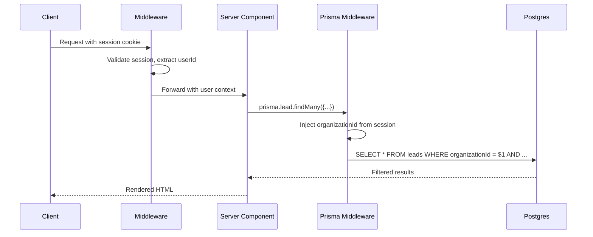
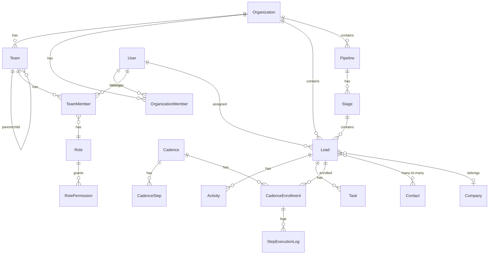
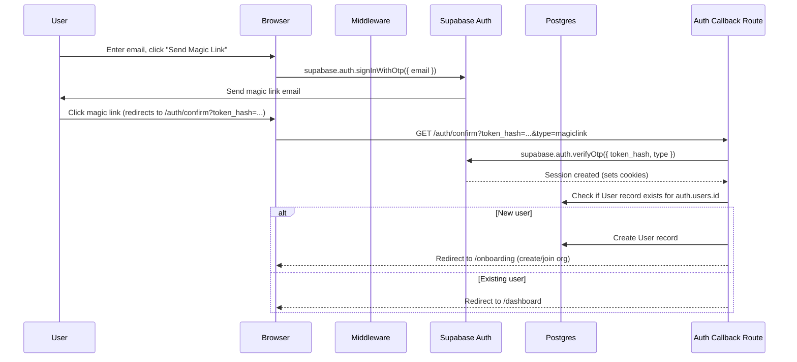
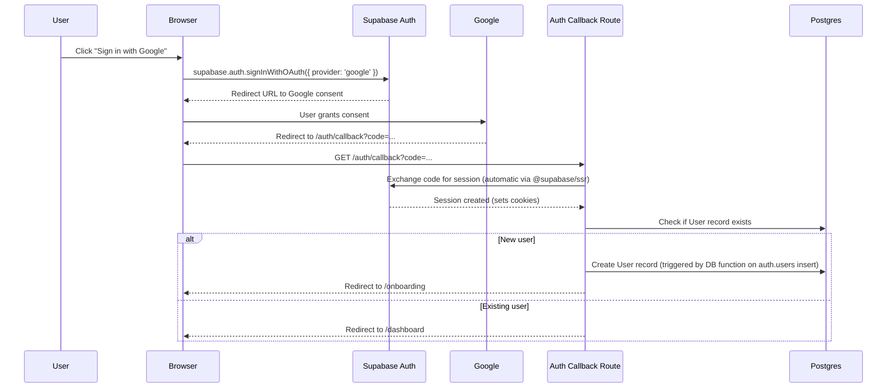
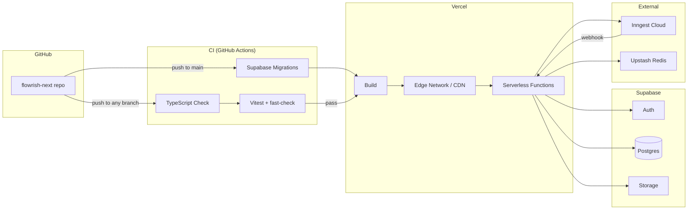

# Design Document: flowrish-next (Next.js + Supabase CRM)

## Overview

This document describes the technical design for **flowrish-next** — a greenfield rebuild of the Flowrish CRM from a Fastify + Vite monorepo into a single Next.js 15 App Router application deployed on Vercel with Supabase as the backend platform.

### Goals

- Consolidate backend API and frontend SPA into a unified Next.js application
- Replace JWT-based auth with Supabase Auth cookie-based sessions
- Replace BullMQ workers with Inngest durable functions
- Replace direct Redis with Upstash Redis (serverless-compatible)
- Introduce multi-tenant Organization model with flexible team hierarchies and custom RBAC
- Maintain feature parity with all 20+ existing modules (leads, cadences, scoring, rhythm, forecasting, etc.)
- Achieve zero-downtime deployment via Vercel with GitHub Actions CI

### Key Design Decisions

| Decision | Rationale |
|----------|-----------|
| Next.js App Router (RSC + Server Actions) | Eliminates separate API server; co-locates data fetching with UI |
| Supabase Auth with `@supabase/ssr` | Cookie-based sessions work across RSC, Server Actions, Route Handlers, and Middleware without client-side token management |
| Prisma v6 with middleware-based tenant isolation | Automatic `organizationId` injection prevents cross-tenant data leakage at the ORM level |
| Inngest for background jobs | Durable functions with built-in retry, scheduling, and step orchestration — no Redis dependency for job queues |
| Upstash Redis (REST-based) | Serverless-compatible rate limiting and round-robin state without persistent connections |
| TanStack Query v5 + Zustand v5 | Clear separation: server state (TQ) vs client UI state (Zustand) |
| Vitest + fast-check | Property-based testing for correctness invariants; co-located test files |

---

## Architecture

### High-Level System Diagram

```mermaid
graph TB
    subgraph "Client (Browser)"
        UI[React 19 UI<br/>Shadcn/ui + TailwindCSS v4]
        TQ[TanStack Query v5]
        ZS[Zustand v5 Stores]
    end

    subgraph "Vercel Edge/Serverless"
        MW[Next.js Middleware<br/>Auth + Security Headers + Rate Limiting]
        RSC[Server Components<br/>Data Fetching + Rendering]
        SA[Server Actions<br/>Mutations + Validation]
        RH[Route Handlers<br/>Webhooks + API endpoints]
        INN[Inngest Serve Endpoint<br/>/api/inngest]
    end

    subgraph "Supabase Platform"
        AUTH[Supabase Auth<br/>Magic Link + Google OAuth]
        PG[(Supabase Postgres<br/>+ Prisma v6 ORM)]
        STOR[Supabase Storage<br/>File Attachments]
        RLS[Row Level Security<br/>Storage Policies]
    end

    subgraph "External Services"
        UPSTASH[Upstash Redis<br/>Rate Limiting + Round-Robin]
        INNGEST[Inngest Cloud<br/>Durable Functions]
        GMAIL[Gmail API<br/>Email Send/Sync]
        GEMINI[Google Gemini API<br/>AI Features]
    end

    UI --> TQ
    UI --> ZS
    TQ --> RSC
    TQ --> SA
    UI --> SA
    MW --> RSC
    MW --> SA
    MW --> RH
    RSC --> PG
    SA --> PG
    RH --> PG
    SA --> UPSTASH
    MW --> UPSTASH
    INN --> INNGEST
    INNGEST --> PG
    INNGEST --> GMAIL
    SA --> GEMINI
    RSC --> AUTH
    SA --> AUTH
    MW --> AUTH
    SA --> STOR
    STOR --> RLS
    → Set security headers
    → Check rate limit (Upstash Redis)
    → Route to handler
      → Server Component (read path)
      → Server Action (mutation path)
      → Route Handler (API path)
        → Zod input validation
        → Permission check (RBAC)
        → Prisma query (with organizationId middleware)
        → Audit log (async, non-blocking)
        → Response
```

### Multi-Tenancy Data Flow



### Folder Structure

```
src/
├── app/                          # Next.js App Router
│   ├── (auth)/                   # Auth routes (no layout shell)
│   │   ├── login/page.tsx
│   │   ├── auth/callback/route.ts
│   │   └── auth/confirm/route.ts
│   ├── (dashboard)/              # Authenticated routes (with shell layout)
│   │   ├── layout.tsx            # Shell with sidebar + header
│   │   ├── page.tsx              # Dashboard
│   │   ├── leads/
│   │   ├── contacts/
│   │   ├── companies/
│   │   ├── pipeline/
│   │   ├── cadences/
│   │   ├── tasks/
│   │   ├── rhythm/
│   │   ├── forecast/
│   │   ├── search/
│   │   ├── csv/
│   │   ├── settings/
│   │   └── admin/
│   ├── api/                      # Route Handlers
│   │   ├── inngest/route.ts      # Inngest serve endpoint
│   │   ├── leads/
│   │   ├── activities/
│   │   ├── cadences/
│   │   ├── email/
│   │   ├── ai/
│   │   ├── search/
│   │   ├── forecast/
│   │   └── upload/
│   ├── layout.tsx                # Root layout (providers)
│   └── globals.css
├── components/                   # Shared UI components
│   ├── ui/                       # Shadcn/ui primitives
│   ├── layout/                   # Shell, Sidebar, Header
│   ├── leads/                    # Lead-specific components
│   ├── activities/               # Activity timeline
│   ├── cadences/                 # Cadence builder
│   ├── pipeline/                 # Kanban board
│   ├── rhythm/                   # Rhythm dashboard
│   ├── ai/                       # AI chatbot, email gen
│   ├── email/                    # Email compose, connect
│   ├── csv/                      # Import/export wizard
│   ├── search/                   # Search interface
│   ├── forecast/                 # Forecast panels
│   └── admin/                    # User management, audit
├── server/                       # Server-only code
│   ├── db/                       # Prisma client + middleware
│   │   ├── client.ts             # Prisma client singleton
│   │   ├── middleware.ts         # organizationId injection
│   │   └── seed.ts              # Seed script
│   ├── auth/                     # Auth utilities
│   │   ├── session.ts            # getSession(), requireSession()
│   │   └── permissions.ts        # RBAC checks
│   ├── services/                 # Business logic (server-only)
│   │   ├── leads.ts
│   │   ├── activities.ts
│   │   ├── cadences.ts
│   │   ├── scoring.ts
│   │   ├── assignment.ts
│   │   ├── rhythm.ts
│   │   ├── forecast.ts
│   │   ├── email.ts
│   │   ├── ai.ts
│   │   ├── search.ts
│   │   └── audit.ts
│   ├── inngest/                  # Inngest functions
│   │   ├── client.ts             # Inngest client instance
│   │   ├── cadence-step.ts
│   │   ├── email-sync.ts
│   │   ├── score-decay.ts
│   │   ├── task-reminder.ts
│   │   └── forecast-snapshot.ts
│   └── actions/                  # Server Actions
│       ├── leads.ts
│       ├── activities.ts
│       ├── cadences.ts
│       ├── tasks.ts
│       └── settings.ts
├── lib/                          # Shared utilities
│   ├── env.ts                    # Zod-validated env vars
│   ├── supabase/
│   │   ├── client.ts             # Browser Supabase client
│   │   ├── server.ts             # Server Supabase client
│   │   └── middleware.ts         # Middleware Supabase client
│   ├── upstash/
│   │   ├── redis.ts              # Upstash Redis client
│   │   └── ratelimit.ts          # Rate limiter instances
│   ├── encryption.ts             # AES-256-CBC for OAuth tokens
│   ├── validators/               # Zod schemas
│   │   ├── leads.ts
│   │   ├── activities.ts
│   │   ├── cadences.ts
│   │   ├── tasks.ts
│   │   └── common.ts
│   └── utils.ts                  # General utilities
├── hooks/                        # Custom React hooks
│   ├── use-leads.ts
│   ├── use-activities.ts
│   ├── use-cadences.ts
│   └── use-permissions.ts
├── stores/                       # Zustand stores
│   ├── layout.ts                 # Sidebar, chatbot state
│   ├── filters.ts                # Global filter state
│   └── kanban.ts                 # Drag state
├── types/                        # TypeScript types
│   ├── database.ts               # Prisma-generated types re-exports
│   ├── api.ts                    # API request/response types
│   └── permissions.ts            # Permission enums
└── middleware.ts                  # Next.js middleware (root)
```

---

## Components and Interfaces

### Authentication Components

#### Supabase Client Factory

Three Supabase client variants for different execution contexts:

```typescript
// lib/supabase/server.ts — Server Components & Server Actions
import { createServerClient } from '@supabase/ssr'
import { cookies } from 'next/headers'

export async function createSupabaseServer() {
  const cookieStore = await cookies()
  return createServerClient(env.NEXT_PUBLIC_SUPABASE_URL, env.NEXT_PUBLIC_SUPABASE_ANON_KEY, {
    cookies: {
      getAll: () => cookieStore.getAll(),
      setAll: (cookiesToSet) => {
        cookiesToSet.forEach(({ name, value, options }) =>
          cookieStore.set(name, value, options))
      },
    },
  })
}

// lib/supabase/middleware.ts — Next.js Middleware
import { createServerClient } from '@supabase/ssr'
import { NextRequest, NextResponse } from 'next/server'

export function createSupabaseMiddleware(request: NextRequest, response: NextResponse) {
  return createServerClient(env.NEXT_PUBLIC_SUPABASE_URL, env.NEXT_PUBLIC_SUPABASE_ANON_KEY, {
    cookies: {
      getAll: () => request.cookies.getAll(),
      setAll: (cookiesToSet) => {
        cookiesToSet.forEach(({ name, value, options }) => {
          request.cookies.set(name, value)
          response.cookies.set(name, value, options)
        })
      },
    },
  })
}

// lib/supabase/client.ts — Browser (Client Components)
import { createBrowserClient } from '@supabase/ssr'

export function createSupabaseBrowser() {
  return createBrowserClient(env.NEXT_PUBLIC_SUPABASE_URL, env.NEXT_PUBLIC_SUPABASE_ANON_KEY)
}
```

#### Session Utilities

```typescript
// server/auth/session.ts
import { createSupabaseServer } from '@/lib/supabase/server'
import { prisma } from '@/server/db/client'

export async function getSession() {
  const supabase = await createSupabaseServer()
  const { data: { user } } = await supabase.auth.getUser()
  if (!user) return null

  const dbUser = await prisma.user.findUnique({
    where: { authId: user.id },
    include: {
      teamMemberships: {
        include: { team: true, role: { include: { permissions: true } } }
      }
    }
  })

  return dbUser ? { authUser: user, dbUser } : null
}

export async function requireSession() {
  const session = await getSession()
  if (!session) throw new AuthError('Unauthorized', 401)
  return session
}
```

#### Permission Checker

```typescript
// server/auth/permissions.ts
type Permission = 
  | 'leads:read' | 'leads:write' | 'leads:delete'
  | 'contacts:read' | 'contacts:write'
  | 'cadences:manage' | 'cadences:read'
  | 'users:invite' | 'users:manage'
  | 'billing:manage'
  | 'settings:manage'
  | 'audit:read'
  | 'forecast:read' | 'forecast:submit'

export function hasPermission(user: SessionUser, permission: Permission): boolean {
  // Compute effective permissions as union of all team role permissions
  const effectivePermissions = new Set<string>()
  for (const membership of user.teamMemberships) {
    for (const perm of membership.role.permissions) {
      effectivePermissions.add(perm.key)
    }
  }
  return effectivePermissions.has(permission)
}

export function requirePermission(user: SessionUser, permission: Permission): void {
  if (!hasPermission(user, permission)) {
    throw new AppError('FORBIDDEN', 'Insufficient permissions', 403)
  }
}
```

### Prisma Middleware for Tenant Isolation

```typescript
// server/db/middleware.ts
import { Prisma } from '@prisma/client'

const TENANT_SCOPED_MODELS = [
  'Lead', 'Contact', 'Company', 'Activity', 'Task', 'Pipeline', 'Stage',
  'Cadence', 'CadenceStep', 'CadenceEnrollment', 'StepExecutionLog',
  'ScoringRule', 'ScoreDecayConfig', 'AssignmentRule', 'EmailAccount',
  'EmailMessage', 'AuditEntry', 'FileAttachment', 'ForecastSubmission',
  'ForecastSnapshot', 'CoachingComment', 'AiPromptConfig', 'DeletionRequest'
]

export function tenantIsolationMiddleware(organizationId: string): Prisma.Middleware {
  return async (params, next) => {
    if (!TENANT_SCOPED_MODELS.includes(params.model ?? '')) {
      return next(params)
    }

    // Inject organizationId into create operations
    if (params.action === 'create') {
      params.args.data.organizationId = organizationId
    }
    if (params.action === 'createMany') {
      for (const item of params.args.data) {
        item.organizationId = organizationId
      }
    }

    // Inject organizationId filter into all read/update/delete operations
    if (['findMany', 'findFirst', 'findUnique', 'count', 'aggregate', 'groupBy'].includes(params.action)) {
      params.args.where = { ...params.args.where, organizationId }
    }
    if (['update', 'updateMany', 'delete', 'deleteMany'].includes(params.action)) {
      params.args.where = { ...params.args.where, organizationId }
    }

    return next(params)
  }
}
```

### Inngest Client and Functions

```typescript
// server/inngest/client.ts
import { Inngest } from 'inngest'

export const inngest = new Inngest({
  id: 'flowrish-next',
  signingKey: env.INNGEST_SIGNING_KEY,
})

// server/inngest/cadence-step.ts
import { inngest } from './client'

export const cadenceStepFunction = inngest.createFunction(
  {
    id: 'cadence-step-execution',
    retries: 3,
  },
  { event: 'cadence/step.execute' },
  async ({ event, step }) => {
    const { enrollmentId, stepId, cadenceId, leadId } = event.data

    // Step 1: Verify enrollment is still active
    const enrollment = await step.run('verify-enrollment', async () => {
      return prisma.cadenceEnrollment.findUnique({
        where: { id: enrollmentId },
        select: { status: true, currentStepOrder: true }
      })
    })

    if (!enrollment || enrollment.status !== 'ACTIVE') {
      return { skipped: true, reason: 'enrollment_not_active' }
    }

    // Step 2: Execute the action (email, call, task creation)
    await step.run('execute-action', async () => {
      await cadenceService.executeStep(enrollmentId, stepId)
    })

    // Step 3: Schedule next step if exists
    const nextStep = await step.run('get-next-step', async () => {
      return prisma.cadenceStep.findFirst({
        where: { cadenceId, stepOrder: enrollment.currentStepOrder + 1 }
      })
    })

    if (nextStep) {
      await step.sleep('wait-for-delay', `${nextStep.delayHours}h`)
      await inngest.send({
        name: 'cadence/step.execute',
        data: { enrollmentId, stepId: nextStep.id, cadenceId, leadId }
      })
    }

    return { executed: true }
  }
)
```

### Rate Limiting

```typescript
// lib/upstash/ratelimit.ts
import { Ratelimit } from '@upstash/ratelimit'
import { Redis } from '@upstash/redis'

const redis = new Redis({
  url: env.UPSTASH_REDIS_REST_URL,
  token: env.UPSTASH_REDIS_REST_TOKEN,
})

export const rateLimiters = {
  general: new Ratelimit({
    redis,
    limiter: Ratelimit.slidingWindow(100, '1m'),
    prefix: 'rl:general',
  }),
  auth: new Ratelimit({
    redis,
    limiter: Ratelimit.slidingWindow(10, '1m'),
    prefix: 'rl:auth',
  }),
  write: new Ratelimit({
    redis,
    limiter: Ratelimit.slidingWindow(30, '1m'),
    prefix: 'rl:write',
  }),
}

// Login brute-force protection
export async function recordLoginFailure(ip: string, email: string): Promise<boolean> {
  const key = `login_attempt:${ip}:${email.toLowerCase()}`
  const attempts = await redis.incr(key)
  if (attempts === 1) await redis.expire(key, 900) // 15 min window

  if (attempts >= 5) {
    const lockKey = `login_lockout:${ip}:${email.toLowerCase()}`
    await redis.set(lockKey, '1', { ex: 900 }) // 15 min lockout
    return true
  }
  return false
}

export async function isLoginLockedOut(ip: string, email: string): Promise<boolean> {
  const lockKey = `login_lockout:${ip}:${email.toLowerCase()}`
  return (await redis.get(lockKey)) !== null
}

export async function clearLoginFailures(ip: string, email: string): Promise<void> {
  const key = `login_attempt:${ip}:${email.toLowerCase()}`
  const lockKey = `login_lockout:${ip}:${email.toLowerCase()}`
  await redis.del(key, lockKey)
}
```

### Next.js Middleware

```typescript
// middleware.ts
import { NextRequest, NextResponse } from 'next/server'
import { createSupabaseMiddleware } from '@/lib/supabase/middleware'
import { rateLimiters } from '@/lib/upstash/ratelimit'

const PUBLIC_ROUTES = ['/login', '/auth/callback', '/auth/confirm']

export async function middleware(request: NextRequest) {
  const response = NextResponse.next()

  // Security headers
  response.headers.set('X-Content-Type-Options', 'nosniff')
  response.headers.set('X-Frame-Options', 'DENY')
  response.headers.set('Referrer-Policy', 'strict-origin-when-cross-origin')
  response.headers.set('Permissions-Policy', 'camera=(), microphone=(), geolocation=(), payment=()')
  response.headers.set('Strict-Transport-Security', 'max-age=31536000; includeSubDomains')

  // Rate limiting
  const ip = request.headers.get('x-forwarded-for')?.split(',')[0] ?? '127.0.0.1'
  const path = request.nextUrl.pathname

  if (!path.startsWith('/_next') && !path.startsWith('/favicon')) {
    const limiter = path.startsWith('/api/auth') ? rateLimiters.auth
      : ['POST', 'PUT', 'DELETE', 'PATCH'].includes(request.method) ? rateLimiters.write
      : rateLimiters.general

    const { success, limit, remaining, reset } = await limiter.limit(ip)
    response.headers.set('X-RateLimit-Limit', limit.toString())
    response.headers.set('X-RateLimit-Remaining', remaining.toString())
    response.headers.set('X-RateLimit-Reset', reset.toString())

    if (!success) {
      return NextResponse.json(
        { error: { code: 'RATE_LIMITED', message: 'Too many requests' } },
        { status: 429, headers: Object.fromEntries(response.headers) }
      )
    }
  }

  // Auth check
  const supabase = createSupabaseMiddleware(request, response)
  const { data: { user } } = await supabase.auth.getUser()

  const isPublicRoute = PUBLIC_ROUTES.some(r => path.startsWith(r))
  const isApiRoute = path.startsWith('/api/')

  if (!user && !isPublicRoute && !isApiRoute) {
    return NextResponse.redirect(new URL('/login', request.url))
  }

  if (!user && isApiRoute && !path.startsWith('/api/auth') && !path.startsWith('/api/inngest')) {
    return NextResponse.json(
      { error: { code: 'UNAUTHORIZED', message: 'Authentication required' } },
      { status: 401 }
    )
  }

  return response
}

export const config = {
  matcher: ['/((?!_next/static|_next/image|favicon.ico).*)'],
}
```

---

## Data Models

### Evolved Prisma Schema (Multi-Tenant)

The schema evolves the existing single-tenant model by adding Organization, Team, Role, and Permission models, and adding `organizationId` to all data models.

```prisma
// ─── Multi-Tenancy Models ────────────────────────────────────────────────────

model Organization {
  id        String   @id @default(uuid())
  name      String
  slug      String   @unique  // URL-safe, e.g. "acme-corp"
  plan      String   @default("free")  // free, pro, enterprise
  createdAt DateTime @default(now())
  updatedAt DateTime @updatedAt

  teams              Team[]
  users              OrganizationMember[]
  leads              Lead[]
  contacts           Contact[]
  companies          Company[]
  pipelines          Pipeline[]
  cadences           Cadence[]
  scoringRules       ScoringRule[]
  assignmentRules    AssignmentRule[]
  aiPromptConfigs    AiPromptConfig[]
  scoreDecayConfigs  ScoreDecayConfig[]
  invites            OrganizationInvite[]
}

model OrganizationMember {
  id             String       @id @default(uuid())
  userId         String
  organizationId String
  user           User         @relation(fields: [userId], references: [id])
  organization   Organization @relation(fields: [organizationId], references: [id])
  isDefault      Boolean      @default(false)  // User's default org
  joinedAt       DateTime     @default(now())

  @@unique([userId, organizationId])
  @@index([organizationId])
}

model OrganizationInvite {
  id             String       @id @default(uuid())
  email          String
  organizationId String
  organization   Organization @relation(fields: [organizationId], references: [id])
  roleId         String
  role           Role         @relation(fields: [roleId], references: [id])
  teamId         String?
  invitedById    String
  status         String       @default("pending")  // pending, accepted, expired
  expiresAt      DateTime
  createdAt      DateTime     @default(now())

  @@index([email, organizationId])
  @@index([status])
}

model Team {
  id             String       @id @default(uuid())
  name           String
  organizationId String
  organization   Organization @relation(fields: [organizationId], references: [id])
  parentTeamId   String?
  parentTeam     Team?        @relation("TeamHierarchy", fields: [parentTeamId], references: [id])
  childTeams     Team[]       @relation("TeamHierarchy")
  members        TeamMember[]
  createdAt      DateTime     @default(now())
  updatedAt      DateTime     @updatedAt

  @@index([organizationId])
  @@index([parentTeamId])
}

model TeamMember {
  id     String @id @default(uuid())
  userId String
  teamId String
  roleId String
  user   User   @relation(fields: [userId], references: [id])
  team   Team   @relation(fields: [teamId], references: [id])
  role   Role   @relation(fields: [roleId], references: [id])

  @@unique([userId, teamId])
  @@index([teamId])
}

model Role {
  id             String       @id @default(uuid())
  name           String       // OWNER, ADMIN, MANAGER, MEMBER, or custom
  organizationId String?      // null = system default role
  isSystem       Boolean      @default(false)  // true for OWNER/ADMIN/MANAGER/MEMBER
  hierarchy      Int          // Lower = more powerful (OWNER=0, ADMIN=1, MANAGER=2, MEMBER=3)
  permissions    RolePermission[]
  teamMembers    TeamMember[]
  invites        OrganizationInvite[]
  createdAt      DateTime     @default(now())

  @@unique([name, organizationId])
  @@index([organizationId])
}

model RolePermission {
  id     String @id @default(uuid())
  roleId String
  role   Role   @relation(fields: [roleId], references: [id], onDelete: Cascade)
  key    String // e.g. "leads:read", "leads:write", "cadences:manage"

  @@unique([roleId, key])
}

// ─── User Model (Updated) ────────────────────────────────────────────────────

model User {
  id        String   @id @default(uuid())
  authId    String   @unique  // Supabase auth.users.id
  email     String   @unique
  name      String
  avatarUrl String?
  createdAt DateTime @default(now())
  updatedAt DateTime @updatedAt

  organizationMemberships OrganizationMember[]
  teamMemberships         TeamMember[]
  assignedLeads           Lead[]
  tasks                   Task[]
  auditEntries            AuditEntry[]
  emailAccounts           EmailAccount[]
  cadencesCreated         Cadence[]           @relation("cadencesCreated")
  enrollmentsCreated      CadenceEnrollment[] @relation("enrollmentsCreated")
  coachingComments        CoachingComment[]   @relation("coachingComments")
  forecastSubmissions     ForecastSubmission[] @relation("forecastSubmissions")
  deletionRequests        DeletionRequest[]   @relation("deletionRequests")
}
```

### Key Schema Changes from Existing System

| Change | Rationale |
|--------|-----------|
| Added `Organization`, `Team`, `TeamMember`, `Role`, `RolePermission` models | Multi-tenancy support |
| Added `organizationId` FK to all data models | Tenant isolation |
| Replaced `role` enum on User with `Role` model + `TeamMember` | Flexible per-team role assignment |
| Added `authId` to User (maps to Supabase auth.users.id) | Supabase Auth integration |
| Removed `googleId`, `authProvider` from User | Supabase Auth handles provider tracking |
| Added `OrganizationInvite` model | Invite-based org joining |
| Added `OrganizationMember` model | User ↔ Organization many-to-many |
| All models gain `organizationId` field + index | Query performance for tenant-scoped reads |
| Added `isClosed`, `closeDate` to Lead | Track closed state for forecasting/analytics |
| Added `isClosedWon`, `isClosedLost` to Stage | Identify terminal pipeline stages |
| Added `FieldMapping` model with `organizationId` | Reusable CSV import mappings per org |
| Retained `CoachingComment` model with `organizationId` | Manager coaching on activities |

### Entity Relationship Diagram (Core)



---


## API Design

### Route Handlers (REST API)

Route Handlers are used for operations that need to be called from client components, external services, or webhooks.

| Method | Path | Purpose | Auth |
|--------|------|---------|------|
| POST | `/api/auth/login` | Initiate magic link | Public |
| GET | `/api/auth/callback` | OAuth callback | Public |
| POST | `/api/inngest` | Inngest webhook endpoint | Inngest signature |
| GET | `/api/leads` | List leads (paginated) | Session |
| POST | `/api/leads` | Create lead | Session + `leads:write` |
| GET | `/api/leads/[id]` | Get lead detail | Session + `leads:read` |
| PATCH | `/api/leads/[id]` | Update lead | Session + `leads:write` |
| DELETE | `/api/leads/[id]` | Soft-delete lead | Session + `leads:delete` |
| POST | `/api/activities` | Log activity | Session + `leads:write` |
| GET | `/api/activities/[leadId]` | Get lead activities | Session + `leads:read` |
| POST | `/api/cadences` | Create cadence | Session + `cadences:manage` |
| PATCH | `/api/cadences/[id]/activate` | Activate cadence | Session + `cadences:manage` |
| POST | `/api/cadences/[id]/enroll` | Enroll lead | Session + `cadences:manage` |
| POST | `/api/email/connect` | Start Gmail OAuth | Session |
| POST | `/api/email/send` | Send email | Session + `leads:write` |
| POST | `/api/ai/generate-email` | AI email draft | Session + `leads:read` |
| POST | `/api/ai/research` | AI account research | Session + `leads:read` |
| POST | `/api/ai/chat` | AI chatbot message | Session |
| GET | `/api/search` | Full-text search | Session |
| POST | `/api/csv/import` | CSV import | Session + `leads:write` |
| GET | `/api/csv/export` | CSV export | Session + `leads:read` |
| POST | `/api/upload` | File upload | Session + `leads:write` |
| GET | `/api/forecast` | Get forecast data | Session + `forecast:read` |
| POST | `/api/forecast/submit` | Submit forecast | Session + `forecast:submit` |
| GET | `/api/forecast/compare` | Forecast comparison (commit vs AI) | Session + `forecast:read` |
| GET | `/api/dashboard/pipeline-value` | Pipeline value per stage | Session |
| GET | `/api/dashboard/conversion-rates` | Stage conversion rates | Session |
| GET | `/api/dashboard/stage-duration` | Average time in stage | Session |
| GET | `/api/dashboard/lead-counts` | Lead count per stage | Session |
| GET | `/api/dashboard/closed-summary` | Closed won/lost summary | Session |
| POST | `/api/duplicates/check` | Check for duplicate leads | Session + `leads:read` |
| POST | `/api/leads/[id]/merge` | Merge secondary lead into primary | Session + `leads:write` |
| POST | `/api/leads/[id]/convert` | Convert lead to contact | Session + `leads:write` |
| POST | `/api/rhythm/coaching/[activityId]` | Add coaching comment | Session + `leads:write` |
| GET | `/api/rhythm/coaching/[activityId]` | Get coaching comments | Session + `leads:read` |
| POST | `/api/rhythm/conversations/[activityId]/summarize` | AI meeting summary | Session |
| GET | `/api/rhythm/conversations/lead/[leadId]` | Lead conversation history | Session + `leads:read` |
| POST | `/api/deletion-requests` | Request entity deletion | Session |
| GET | `/api/deletion-requests` | List deletion requests | Session + `settings:manage` |
| PATCH | `/api/deletion-requests/[id]/approve` | Approve deletion | Session + `settings:manage` |
| PATCH | `/api/deletion-requests/[id]/reject` | Reject deletion | Session + `settings:manage` |

### Server Actions

Server Actions are used for form submissions and mutations from Server Components:

```typescript
// server/actions/leads.ts
'use server'

import { z } from 'zod'
import { requireSession } from '@/server/auth/session'
import { requirePermission } from '@/server/auth/permissions'
import { createTenantPrisma } from '@/server/db/client'
import { leadCreateSchema } from '@/lib/validators/leads'
import { revalidatePath } from 'next/cache'

export async function createLead(formData: FormData) {
  const session = await requireSession()
  requirePermission(session.dbUser, 'leads:write')

  const prisma = createTenantPrisma(session.dbUser.organizationId)
  const data = leadCreateSchema.parse(Object.fromEntries(formData))

  const lead = await prisma.lead.create({ data })

  // Async audit log (non-blocking)
  auditLog({ userId: session.dbUser.id, action: 'CREATE', entityType: 'Lead', entityId: lead.id })

  revalidatePath('/leads')
  return { success: true, id: lead.id }
}
```

### Route Handler Pattern

```typescript
// app/api/leads/route.ts
import { NextRequest, NextResponse } from 'next/server'
import { requireSession } from '@/server/auth/session'
import { requirePermission } from '@/server/auth/permissions'
import { createTenantPrisma } from '@/server/db/client'
import { leadCreateSchema } from '@/lib/validators/leads'

export async function GET(request: NextRequest) {
  const session = await requireSession()
  requirePermission(session.dbUser, 'leads:read')

  const prisma = createTenantPrisma(session.dbUser.organizationId)
  const { searchParams } = request.nextUrl
  const page = parseInt(searchParams.get('page') ?? '1')
  const limit = parseInt(searchParams.get('limit') ?? '20')

  const [leads, total] = await Promise.all([
    prisma.lead.findMany({
      where: { deletedAt: null },
      skip: (page - 1) * limit,
      take: limit,
      orderBy: { createdAt: 'desc' },
    }),
    prisma.lead.count({ where: { deletedAt: null } }),
  ])

  return NextResponse.json({ data: leads, total, page, limit })
}

export async function POST(request: NextRequest) {
  const session = await requireSession()
  requirePermission(session.dbUser, 'leads:write')

  const prisma = createTenantPrisma(session.dbUser.organizationId)
  const body = await request.json()
  const data = leadCreateSchema.parse(body)

  const lead = await prisma.lead.create({ data: { ...data, assignedUserId: session.dbUser.id } })

  return NextResponse.json({ data: lead }, { status: 201 })
}
```

### Error Response Format

All API errors follow a consistent schema:

```typescript
// lib/errors.ts
export class AppError extends Error {
  constructor(
    public code: string,
    public override message: string,
    public statusCode: number = 500,
  ) {
    super(message)
  }
}

// Consistent error response helper
export function errorResponse(error: unknown): NextResponse {
  if (error instanceof AppError) {
    return NextResponse.json(
      { error: { code: error.code, message: error.message } },
      { status: error.statusCode }
    )
  }
  if (error instanceof z.ZodError) {
    return NextResponse.json(
      { error: { code: 'VALIDATION_ERROR', message: error.errors[0].message } },
      { status: 400 }
    )
  }
  // Never expose internals
  console.error('Unhandled error:', error)
  return NextResponse.json(
    { error: { code: 'INTERNAL_ERROR', message: 'An unexpected error occurred' } },
    { status: 500 }
  )
}
```

---

## Authentication Flow

### Magic Link Flow



### Google OAuth Flow



### Session Validation in Server Components

```typescript
// app/(dashboard)/layout.tsx
import { getSession } from '@/server/auth/session'
import { redirect } from 'next/navigation'

export default async function DashboardLayout({ children }: { children: React.ReactNode }) {
  const session = await getSession()
  if (!session) redirect('/login')

  return (
    <Shell user={session.dbUser}>
      {children}
    </Shell>
  )
}
```

---

## Multi-Tenancy Implementation

### Tenant Context Resolution

The tenant context is always derived server-side from the authenticated user's session:

1. **Middleware** validates the session cookie and extracts the Supabase user
2. **Server Components/Actions** call `getSession()` which fetches the User record with their `organizationId`
3. **Prisma middleware** automatically injects `organizationId` into all queries
4. **No endpoint** accepts `organizationId` as a client parameter

### Prisma Client with Tenant Scope

```typescript
// server/db/client.ts
import { PrismaClient } from '@prisma/client'
import { tenantIsolationMiddleware } from './middleware'

// Global singleton (development hot-reload safe)
const globalForPrisma = globalThis as unknown as { prisma: PrismaClient }
export const prisma = globalForPrisma.prisma ?? new PrismaClient()
if (process.env.NODE_ENV !== 'production') globalForPrisma.prisma = prisma

// Create a tenant-scoped client
export function createTenantPrisma(organizationId: string) {
  const client = prisma.$extends({
    query: {
      $allModels: {
        async $allOperations({ model, operation, args, query }) {
          // Inject organizationId for tenant-scoped models
          if (TENANT_SCOPED_MODELS.includes(model)) {
            if (operation === 'create') {
              args.data = { ...args.data, organizationId }
            }
            if (['findMany', 'findFirst', 'count', 'updateMany', 'deleteMany'].includes(operation)) {
              args.where = { ...args.where, organizationId }
            }
            if (['update', 'delete', 'findUnique'].includes(operation)) {
              // For unique operations, add organizationId to where clause
              args.where = { ...args.where, organizationId }
            }
          }
          return query(args)
        }
      }
    }
  })
  return client
}
```

### Supabase Storage RLS

Storage buckets are organized per-organization:

```sql
-- Storage bucket policy: users can only access files in their organization's folder
CREATE POLICY "org_file_access" ON storage.objects
  FOR ALL USING (
    bucket_id = 'attachments'
    AND (storage.foldername(name))[1] = (
      SELECT om.organization_id FROM organization_members om
      WHERE om.user_id = auth.uid()
      AND om.is_default = true
    )
  );
```

File paths follow the pattern: `attachments/{organizationId}/{leadId}/{filename}`

### Permission Inheritance (Team Hierarchy)

```typescript
// server/auth/permissions.ts
export async function getEffectivePermissions(userId: string, organizationId: string): Promise<Set<string>> {
  const memberships = await prisma.teamMember.findMany({
    where: { userId, team: { organizationId } },
    include: { role: { include: { permissions: true } }, team: true }
  })

  const permissions = new Set<string>()

  for (const membership of memberships) {
    // Add direct role permissions
    for (const perm of membership.role.permissions) {
      permissions.add(perm.key)
    }

    // MANAGER of parent team gets MANAGER access to sub-teams
    if (membership.role.hierarchy <= 2) { // MANAGER or above
      const subTeamIds = await getSubTeamIds(membership.teamId)
      // Permissions already cover sub-team data via team hierarchy queries
    }
  }

  return permissions
}

// Get all descendant team IDs (recursive)
async function getSubTeamIds(teamId: string): Promise<string[]> {
  const children = await prisma.team.findMany({
    where: { parentTeamId: teamId },
    select: { id: true }
  })
  const ids = children.map(c => c.id)
  for (const childId of ids) {
    ids.push(...await getSubTeamIds(childId))
  }
  return ids
}
```

### Lead Access Scoping (RBAC)

```typescript
// server/services/leads.ts
export async function getLeadAccessFilter(user: SessionUser): Promise<Prisma.LeadWhereInput> {
  const highestRole = getHighestRole(user.teamMemberships)

  switch (highestRole.name) {
    case 'OWNER':
    case 'ADMIN':
      // Full org access — organizationId filter is already injected by middleware
      return { deletedAt: null }

    case 'MANAGER': {
      // Access to leads in their teams + sub-teams
      const teamIds = user.teamMemberships.map(m => m.teamId)
      const allTeamIds = [...teamIds]
      for (const id of teamIds) {
        allTeamIds.push(...await getSubTeamIds(id))
      }
      const teamUserIds = await prisma.teamMember.findMany({
        where: { teamId: { in: allTeamIds } },
        select: { userId: true }
      })
      return {
        deletedAt: null,
        assignedUserId: { in: teamUserIds.map(u => u.userId) }
      }
    }

    case 'MEMBER':
    default:
      // Only own assigned leads
      return { deletedAt: null, assignedUserId: user.id }
  }
}
```

---

## Background Job Architecture (Inngest)

### Function Registry

```typescript
// app/api/inngest/route.ts
import { serve } from 'inngest/next'
import { inngest } from '@/server/inngest/client'
import { cadenceStepFunction } from '@/server/inngest/cadence-step'
import { emailSyncFunction } from '@/server/inngest/email-sync'
import { scoreDecayFunction } from '@/server/inngest/score-decay'
import { taskReminderFunction } from '@/server/inngest/task-reminder'
import { forecastSnapshotFunction } from '@/server/inngest/forecast-snapshot'

export const { GET, POST, PUT } = serve({
  client: inngest,
  functions: [
    cadenceStepFunction,
    emailSyncFunction,
    scoreDecayFunction,
    taskReminderFunction,
    forecastSnapshotFunction,
  ],
})
```

### Scheduled Functions

| Function | Schedule | Purpose |
|----------|----------|---------|
| `score-decay` | Daily at 00:00 UTC | Reduce scores for inactive leads |
| `task-reminder` | Hourly | Flag tasks due within 24 hours |
| `forecast-snapshot` | Daily at 01:00 UTC | Create pipeline snapshot |

### Event-Driven Functions

| Function | Trigger Event | Purpose |
|----------|---------------|---------|
| `cadence-step-execution` | `cadence/step.execute` | Execute cadence step with delay |
| `email-sync` | `email/sync.requested` | Sync Gmail inbox |

### Cadence Step Execution (Durable Workflow)

```typescript
// server/inngest/cadence-step.ts
export const cadenceStepFunction = inngest.createFunction(
  { id: 'cadence-step-execution', retries: 3 },
  { event: 'cadence/step.execute' },
  async ({ event, step }) => {
    const { enrollmentId, stepId, cadenceId, leadId, actionType } = event.data

    // Step 1: Verify enrollment is still active (idempotent check)
    const enrollment = await step.run('verify-enrollment', async () => {
      return prisma.cadenceEnrollment.findUnique({
        where: { id: enrollmentId },
        select: { status: true, currentStepOrder: true, organizationId: true }
      })
    })

    if (!enrollment || enrollment.status !== 'ACTIVE') {
      return { skipped: true, reason: 'enrollment_not_active' }
    }

    // Step 2: Check for conditional exits (reply received, meeting booked)
    const shouldExit = await step.run('check-exits', async () => {
      return checkConditionalExits(enrollmentId, leadId)
    })

    if (shouldExit) {
      return { exited: true, reason: shouldExit.reason }
    }

    // Step 3: Execute the action
    await step.run('execute-action', async () => {
      await executeStepAction(enrollmentId, stepId, actionType, leadId, enrollment.organizationId)
    })

    // Step 4: Advance enrollment or complete
    const nextStep = await step.run('advance', async () => {
      return advanceEnrollment(enrollmentId, cadenceId, enrollment.currentStepOrder)
    })

    // Step 5: Schedule next step if exists
    if (nextStep) {
      await step.sleep('delay-before-next', `${nextStep.delayHours}h`)
      await step.sendEvent('schedule-next', {
        name: 'cadence/step.execute',
        data: {
          enrollmentId,
          stepId: nextStep.id,
          cadenceId,
          leadId,
          actionType: nextStep.actionType,
        }
      })
    }

    return { executed: true, nextStep: nextStep?.id ?? null }
  }
)
```

### Score Decay (Scheduled)

```typescript
// server/inngest/score-decay.ts
export const scoreDecayFunction = inngest.createFunction(
  { id: 'daily-score-decay' },
  { cron: '0 0 * * *' },  // Daily at midnight UTC
  async ({ step }) => {
    await step.run('apply-decay', async () => {
      const configs = await prisma.scoreDecayConfig.findMany({ where: { isActive: true } })

      for (const config of configs) {
        const cutoffDate = new Date()
        cutoffDate.setDate(cutoffDate.getDate() - config.inactivityDays)

        const inactiveLeads = await prisma.lead.findMany({
          where: {
            deletedAt: null,
            lastActivityAt: { lt: cutoffDate },
            score: { gt: 0 },
          },
          select: { id: true, score: true, organizationId: true }
        })

        for (const lead of inactiveLeads) {
          const newScore = Math.max(0, lead.score - config.pointReduction)
          await prisma.lead.update({
            where: { id: lead.id },
            data: { score: newScore }
          })
          await prisma.scoreHistory.create({
            data: {
              leadId: lead.id,
              previousScore: lead.score,
              newScore,
              reason: 'decay',
              organizationId: lead.organizationId,
            }
          })
        }
      }
    })
  }
)
```

---

## Security Architecture

### Defense-in-Depth Layers

```
┌─────────────────────────────────────────────────────────┐
│ Layer 1: Vercel Edge (DDoS protection, TLS termination) │
├─────────────────────────────────────────────────────────┤
│ Layer 2: Next.js Middleware                              │
│   • Security headers (CSP, HSTS, X-Frame-Options)       │
│   • Rate limiting (Upstash sliding window)              │
│   • Session validation (Supabase cookie check)          │
│   • Path traversal blocking                             │
├─────────────────────────────────────────────────────────┤
│ Layer 3: Route Handler / Server Action                   │
│   • Zod input validation                                │
│   • Input sanitization (null bytes, prototype pollution) │
│   • RBAC permission check                               │
│   • Request body size enforcement (1 MB max)            │
├─────────────────────────────────────────────────────────┤
│ Layer 4: Prisma Middleware                               │
│   • Automatic organizationId injection                  │
│   • Prevents cross-tenant data access                   │
├─────────────────────────────────────────────────────────┤
│ Layer 5: Database (Supabase Postgres)                    │
│   • RLS policies on storage.objects                     │
│   • Foreign key constraints                             │
│   • Unique constraints preventing duplicates            │
└─────────────────────────────────────────────────────────┘
```

### Input Validation Pipeline

```typescript
// lib/validators/common.ts
import { z } from 'zod'

// Reusable sanitization transforms
export const sanitizedString = z.string()
  .transform(s => s.replace(/\0/g, ''))  // Strip null bytes
  .refine(s => !s.includes('..'), { message: 'Path traversal detected' })
  .refine(s => s.length <= 10000, { message: 'String too long' })

export const safeJsonBody = z.record(z.unknown())
  .refine(obj => !hasPrototypePollution(obj), { message: 'Invalid input' })

function hasPrototypePollution(obj: unknown): boolean {
  if (typeof obj !== 'object' || obj === null) return false
  const keys = Object.keys(obj)
  if (keys.some(k => ['__proto__', 'constructor', 'prototype'].includes(k))) return true
  return Object.values(obj).some(v => hasPrototypePollution(v))
}
```

### OAuth Token Encryption

```typescript
// lib/encryption.ts
import { createCipheriv, createDecipheriv, randomBytes } from 'crypto'

const ALGORITHM = 'aes-256-cbc'
const KEY = Buffer.from(env.EMAIL_ENCRYPTION_KEY, 'hex') // 32 bytes

export function encrypt(text: string): string {
  const iv = randomBytes(16)
  const cipher = createCipheriv(ALGORITHM, KEY, iv)
  const encrypted = Buffer.concat([cipher.update(text, 'utf8'), cipher.final()])
  return `${iv.toString('hex')}:${encrypted.toString('hex')}`
}

export function decrypt(encryptedText: string): string {
  const [ivHex, dataHex] = encryptedText.split(':')
  const iv = Buffer.from(ivHex, 'hex')
  const encrypted = Buffer.from(dataHex, 'hex')
  const decipher = createDecipheriv(ALGORITHM, KEY, iv)
  return Buffer.concat([decipher.update(encrypted), decipher.final()]).toString('utf8')
}
```

### Environment Variable Validation

```typescript
// lib/env.ts
import { z } from 'zod'

const envSchema = z.object({
  // Supabase
  NEXT_PUBLIC_SUPABASE_URL: z.string().url(),
  NEXT_PUBLIC_SUPABASE_ANON_KEY: z.string().min(1),
  SUPABASE_SERVICE_ROLE_KEY: z.string().min(1),

  // Database
  DATABASE_URL: z.string().url(),
  DIRECT_URL: z.string().url(),

  // Upstash Redis
  UPSTASH_REDIS_REST_URL: z.string().url(),
  UPSTASH_REDIS_REST_TOKEN: z.string().min(1),

  // Inngest
  INNGEST_SIGNING_KEY: z.string().min(1),
  INNGEST_EVENT_KEY: z.string().min(1),

  // Google
  GOOGLE_CLIENT_ID: z.string().min(1),
  GOOGLE_CLIENT_SECRET: z.string().min(1),

  // Encryption
  EMAIL_ENCRYPTION_KEY: z.string().length(64), // 32 bytes hex

  // AI
  AI_API_KEY: z.string().min(1),
  AI_API_URL: z.string().url().default('https://generativelanguage.googleapis.com/v1beta/openai'),
  AI_MODEL: z.string().default('gemini-3.1-flash-lite'),
})

export const env = envSchema.parse(process.env)
export type Env = z.infer<typeof envSchema>
```

---

## Deployment Architecture

### Infrastructure Diagram



### CI/CD Pipeline (GitHub Actions)

```yaml
# .github/workflows/ci.yml
name: CI
on: [push, pull_request]

jobs:
  test:
    runs-on: ubuntu-latest
    steps:
      - uses: actions/checkout@v4
      - uses: actions/setup-node@v4
        with: { node-version: '20' }
      - run: npm ci
      - run: npx tsc --noEmit          # TypeScript strict check
      - run: npx vitest --run           # Unit + property tests

  deploy:
    needs: test
    if: github.ref == 'refs/heads/main'
    runs-on: ubuntu-latest
    steps:
      - uses: actions/checkout@v4
      - uses: supabase/setup-cli@v1
      - run: supabase db push --linked  # Apply migrations
        env:
          SUPABASE_ACCESS_TOKEN: ${{ secrets.SUPABASE_ACCESS_TOKEN }}
      # Vercel auto-deploys on push to main (configured via Vercel GitHub integration)
```

### Vercel Configuration

```json
// vercel.json
{
  "framework": "nextjs",
  "buildCommand": "npx prisma generate && next build",
  "installCommand": "npm ci",
  "env": {
    "DATABASE_URL": "@database-url",
    "DIRECT_URL": "@direct-url"
  },
  "headers": [
    {
      "source": "/api/(.*)",
      "headers": [
        { "key": "Cache-Control", "value": "no-store" }
      ]
    }
  ]
}
```

### Database Connection Strategy

| Connection Type | Variable | Usage |
|----------------|----------|-------|
| Pooled (PgBouncer) | `DATABASE_URL` | All application queries via Prisma |
| Direct | `DIRECT_URL` | Migrations, Prisma Studio |

```prisma
// prisma/schema.prisma
datasource db {
  provider  = "postgresql"
  url       = env("DATABASE_URL")
  directUrl = env("DIRECT_URL")
}
```

---

