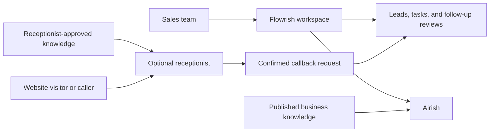

# Flowrish CRM

Flowrish helps sales teams manage leads, follow-ups, and callback requests in separate business workspaces. Airish, the in-app AI assistant, can answer questions, draft text, and propose CRM actions. Optional website and phone reception use each business's own settings and approved knowledge.

[Documentation](docs/README.md) · [Setup](docs/SETUP_GUIDE.md) · [Contributing](CONTRIBUTING.md) · [Security](SECURITY.md) · [MIT license](LICENSE)

## What you can do

| Work | Features | Guide |
|------|----------|-------|
| Manage prospects | Leads, contacts, companies, pipeline stages, saved views, reviewed bulk updates and merges | [User guide](docs/USER_MANUAL.md) |
| Review follow-ups | Reply detection, callback suggestions, task approval, snoozing, search, saved views, and bulk actions | [Follow-up inbox](docs/FOLLOW_UP_INBOX.md) |
| Prepare email replies | Full-conversation drafts, rich-text editing, private draft recovery, and explicit sending | [Conversation drafts](docs/CONVERSATION_DRAFTS.md) |
| Use AI with business context | Published knowledge, source references, tables, and bar/line charts | [Airish](docs/AIRISH.md) |
| Handle enquiries | Business onboarding, approved answers, callback review, CRM handoff, and outcome tracking | [Website receptionist](docs/WEBSITE_RECEPTIONIST.md) |
| Plan sales work | Cadences, priority-ranked daily tasks, lead scoring, and forecasts | [User guide](docs/USER_MANUAL.md) |
| Control access and usage | Workspace membership, roles, outreach restrictions, encrypted provider keys, and AI allowances | [Architecture](docs/ARCHITECTURE.md) |

## How the pieces connect



Website callbacks need a staff-approved CRM handoff. A configured phone receptionist can create CRM callback work after the caller confirms. Drafting a follow-up does not send it; the email composer requires a separate Send action. Activated cadences can send their configured email steps automatically.

Website and phone reception start disabled. Scripted demos and mocked rehearsals do not prove live AI or telephone quality.

## Run your own installation

Use Node.js 22 and your own Supabase, Redis, background-job, and OAuth configuration. The [setup guide](docs/SETUP_GUIDE.md) explains the required values and connection steps.

```sh
git clone https://github.com/marckengland/flowrish-next.git
cd flowrish-next
npm ci
cp .env.example .env
```

Fill in your private development configuration before continuing:

```sh
npx prisma generate
npx prisma migrate deploy
npm run dev
```

Prisma loads this checkout's `.env` with override enabled. Check the database target before a migration; shell datasource variables do not override that file. Never use the hosted Flowrish database for local tests.

The helper launchers, `bash start.sh` and Windows `start.bat`, require Node 22 and stop on installation, generation, or migration failure. They apply migrations to the configured database. See [startup behavior](docs/SETUP_GUIDE.md#start-the-app).

## Verify a change

| Check | Command |
|-------|---------|
| Startup failure handling | `npm run test:startup` |
| Public files and documentation | `npm run test:public-repository` |
| Unit and property tests | `npm test` |
| Lint | `npm run lint` |
| Isolated browser workflows | `npm run test:receptionist:mocked` |
| Production build | `npm run build` |
| Types, after both builds | `npx tsc --noEmit`, then `npm run typecheck:fast` |

The [testing guide](docs/TESTING.md) separates mocked checks, disposable database drills, and authenticated E2E tests. Normal verification must not spend AI allowance, send email, place calls, or enable reception.

## Tech stack

| Part | Tools |
|------|-------|
| Application | Next.js 15, React 19, TypeScript |
| Authentication and data | Supabase Auth, PostgreSQL, Prisma |
| Background work and rate limits | Inngest, Upstash Redis |
| Interface | Tailwind CSS, shadcn/ui, Tiptap |
| Client state | TanStack Query, Zustand |
| Tests | Vitest, fast-check, Testing Library, Playwright |
| Hosting | Vercel and independently configured services |

See the [architecture](docs/ARCHITECTURE.md) for component boundaries and the [data-flow guide](docs/DATA_FLOWS.md) for requests, knowledge, replies, and callbacks.

## Contribute or deploy

Start with [CONTRIBUTING.md](CONTRIBUTING.md). Keep internal plans, personal editor automation, private evidence, credentials, and customer exports outside the public repository.

Forks run validation but do not deploy to Flowrish's services. Configure your own release pipeline; the checked-in production helpers deliberately restrict their targets. See [deployment gates](docs/ops/production-deployment.md).

## License

Flowrish's original code and documentation use the [MIT license](LICENSE). Dependencies retain their own licenses and notices; see [third-party notices](THIRD_PARTY_NOTICES.md). The npm `private` flag prevents accidental package publication and does not control GitHub visibility.
