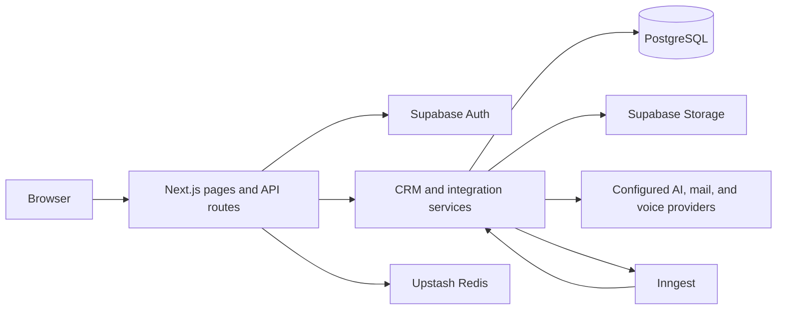
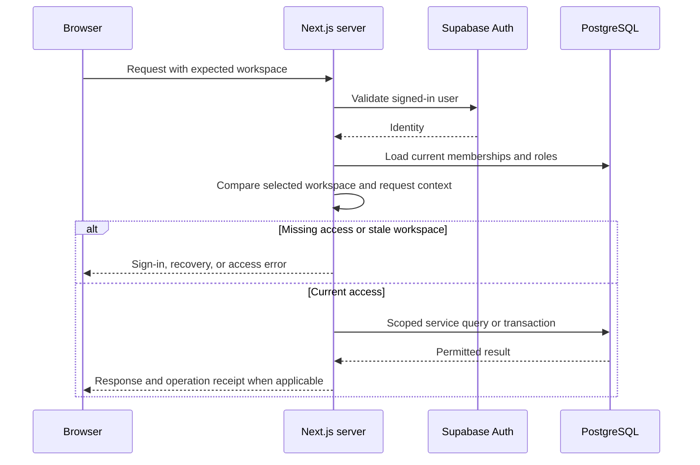

# Flowrish architecture

Flowrish is one Next.js application with server-side CRM services. PostgreSQL stores workspace data; Supabase handles sign-in and attachment storage. Optional integrations provide AI, mailbox access, background jobs, and calling.

This guide explains the boundaries. The [data-flow guide](DATA_FLOWS.md) follows individual workflows, and the [setup guide](SETUP_GUIDE.md) explains configuration.

## System overview

Arrows show calls or data movement, not unrestricted access. Server services check identity, workspace, permissions, and workflow state before returning private data or applying changes. Public receptionist routes use their own session, origin, quota, and consent rules.

| Part | Responsibility | Source |
|------|----------------|--------|
| Pages and API routes | Render screens, validate requests, and call services | [App routes](../src/app/) |
| Client components | Forms, review controls, streaming replies, and recovery state | [Components](../src/components/) |
| Session and access | Validate identity, current membership, roles, and record visibility | [Session](../src/server/auth/session.ts), [lead access](../src/server/services/access.ts) |
| Business services | CRM operations, transactions, integration calls, and receipts | [Services](../src/server/services/) |
| Database schema | Records, relations, indexes, and constraints | [Prisma schema](../prisma/schema.prisma), [migrations](../prisma/migrations/) |
| Background functions | Resume durable work and run scheduled checks | [Registration](../src/app/api/inngest/route.ts), [functions](../src/server/inngest/) |
| Client state | Server-data cache and local interface state | [Hooks](../src/hooks/), [stores](../src/stores/) |

## Identity and workspace access

Supabase identity and application membership are separate. A signed-in person may belong to several businesses. Selecting a business requests a workspace; it does not grant membership.

Without a browser selection, the session uses a retained default membership or the first retained membership. Revoked selections require recovery instead of silently redirecting a write to another business. Sensitive workflow routes also compare the captured account and workspace with the current session.

Permissions come from the union of the user's team-role permissions. Role hierarchy controls lead visibility separately:

| Default role | Lead visibility | Permission defaults |
|--------------|-----------------|---------------------|
| Owner | All active leads in the workspace | All defined permissions |
| Admin | All active leads in the workspace | Administrative and CRM permissions, excluding billing management |
| Manager | Leads assigned to accessible teams and sub-teams | CRM, cadence, and forecast permissions |
| Member | Their assigned leads | Lead/contact read and write, cadence read, forecast read |

These are defaults, not fixed promises. Administrators can change role permissions, and custom roles use the same permission checks. See the [permission definitions](../src/types/permissions.ts), [permission resolver](../src/server/auth/permissions.ts), and [business-switching guide](workspace-switcher.md).

## Data isolation and storage

The Prisma extension injects and filters `organizationId` only for models in its registry. Direct Prisma queries, transactions, and raw SQL still need explicit workspace scoping. Record visibility, current permissions, and version checks belong in the service.

Composite keys and database constraints protect selected cross-record relationships. Row-level security and grants vary by table and migration; server access checks remain necessary. A new model does not become safe merely because it has an organization field.

| Data | Storage | Boundary |
|------|---------|----------|
| CRM records and activity | PostgreSQL | Workspace plus current record access |
| Saved views and follow-up snoozes | PostgreSQL | Workspace and user |
| Published knowledge and approved snapshots | PostgreSQL and full-text indexes | Workspace, publication state, and public approval |
| Follow-up compose recovery | Encrypted database records | Workspace, user, source binding, and revision |
| Attachment bytes | Private Supabase Storage bucket | Authorized upload and signed access |
| Attachment metadata | PostgreSQL | Workspace and related-record access |
| Mailbox OAuth tokens | `EmailAccount` | Connected user and workspace |
| Organization AI and voice credentials | `AiProviderConfig` and `VoiceConfig` | Workspace and administrator access |

Mailbox and voice secrets use the existing AES-256-CBC helper. Organization AI keys and saved follow-up drafts use separate AES-256-GCM formats with context binding. They derive from the server's encryption configuration. Do not replace that key casually: retained encrypted rows need their matching key.

Source: [tenant extension](../src/server/db/middleware.ts), [legacy encryption](../src/lib/encryption.ts), [AI-key encryption](../src/server/services/org-ai-secret.ts), and [saved draft storage](ops/saved-compose-drafts.md).

## Writes, approvals, and retries

A review shows what an operation is about to change. Confirmation rechecks current permissions, records, and versions; the displayed preview is not continuing authorization.

| Workflow | Confirmation boundary | Recovery |
|----------|-----------------------|----------|
| Duplicate merge | Review retained/archive records and blockers | Same review ID retrieves the stored receipt |
| Callback CRM handoff | Review destination, owner, and deadline | Durable handoff receipt prevents duplicate work |
| Follow-up task action | Review approval, completion, or deadline change | Confirmed results and uncertain requests remain distinct |
| Follow-up email | Separate Send action with current source and recipient proof | Unknown results block blind retries |
| Airish CRM action | Confirm action card, unless Autopilot was enabled | Server still checks current access |
| Cadence email step | Earlier activation and enrollment authorize scheduled work | Worker rechecks status and outreach restrictions |

The table describes different contracts. It does not mean every background email waits for a new inbox approval. See [workflow data flows](DATA_FLOWS.md), [lead merges](safe-lead-merges.md), [callback handoff](WEBSITE_RECEPTIONIST.md), and [send-result recovery](ops/send-result-recovery.md).

## AI and business knowledge

Airish retrieves published Library passages. Receptionist callers receive only documents approved for their current published revision. Phone/admin preview can also use the saved receptionist FAQ text; the website assistant does not expose those private phone notes.

Knowledge retrieval uses PostgreSQL full-text search, not embeddings. Publishing a new revision clears public receptionist approval. Retrieved text is treated as answer context rather than authority to execute CRM actions.

Organization AI settings choose the provider and enforce request/token reservations. A configured but paused or exhausted provider fails visibly rather than silently switching to a shared key. Internal AI features can use a deployment fallback when no organization provider is configured; the public website assistant requires its own organization configuration.

See [Airish](AIRISH.md), [knowledge publication](BUSINESS_KNOWLEDGE.md), [provider limits](AI_PROVIDER_SETTINGS.md), and the [knowledge data flow](DATA_FLOWS.md#business-knowledge-and-ai-answers).

## Background work

The registration file is the authoritative list. It currently registers these functions:

| Function ID | Trigger | Work |
|-------------|---------|------|
| `cadence-step-execution` | Event | Execute a configured sequence step |
| `email-sync` | Event | Read a connected mailbox and process pages |
| `mailbox-sync-schedule` | Every five minutes | Queue eligible mailbox checks |
| `score-decay` | Daily | Reduce scores for configured inactivity |
| `task-reminder` | Hourly | Check approaching task deadlines |
| `forecast-snapshot` | Daily | Save forecast metrics |
| `website-receptionist-cleanup` | Daily | Clean up expired website session/feedback data |
| `callback-notifications` | Every five minutes | Update callback attention notifications |
| `callback-response-targets` | Every five minutes | Reconcile response targets and escalation |

Registration and valid deployment keys are required for hosted jobs to run. A configuration indicator is not proof of a successful scheduler run. Durable execution and retries do not replace current access, status, and duplicate checks at each effect.

## Deployment and recovery

Runtime queries and migrations can use different database connections. `prisma.config.ts` loads this checkout's `.env` with override enabled. Temporary shell datasource values do not make that checkout safe for disposable database setup.

The maintainer's release gate waits for tests and reviewed migrations before assigning the production domain. Forks need their own services and release policy. A code revert does not undo data changes or provider acceptance.

Continue with [setup](SETUP_GUIDE.md), [testing](TESTING.md), [deployment gates](ops/production-deployment.md), or the [operations index](ops/README.md).
