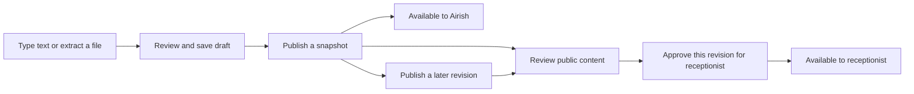

# Add business knowledge for Airish and the receptionist

An administrator can manage the library from **Knowledge library** in the sidebar. Use a separate document for each pricing sheet, service description, or FAQ.

1. Choose **New document**.
2. Enter a title and category.
3. Upload a TXT, Markdown, CSV, text-based PDF, or DOCX file, or enter text directly.
4. Review the extracted text. Correct prices, currency, headings, and table order before saving.
5. Choose **Save draft**, then **Publish for Airish** when the document is ready.

Airish can now retrieve relevant passages and show their source titles and published revisions. Saving later edits changes the draft only. The previous published snapshot stays live until you publish again, unpublish, or archive it.

| State | Airish can retrieve it | Receptionist can retrieve it |
|-------|------------------------|------------------------------|
| Draft only | No | No |
| Published | Yes | No |
| Published and receptionist-approved | Yes | Yes, at the approved revision |
| Draft edits after approval | Previous published snapshot | Previous approved snapshot |
| A new published revision | New snapshot | No, until approved again |
| Unpublished or archived | No | No |

## Approve information for callers

1. Select a published document.
2. Review the **Published snapshot**, including any private details that callers must not receive.
3. Select the acknowledgment checkbox.
4. Choose **Approve for receptionist**.

Approval applies to the displayed published revision. Publishing again clears receptionist approval and requires another review. Editing a draft alone leaves the old approved snapshot available to callers.

To remove a document from caller answers, revoke its receptionist approval. To remove it from both assistants, choose **Unpublish** or **Archive**. The receptionist checks the current approved library on each AI turn. A response already generated or spoken cannot be recalled.

## Resolve an editing conflict

If another administrator changes a document, the server rejects your stale save or approval. Keep a copy of your unsaved edits, reload the latest document, and apply the changes again. Flowrish does not silently overwrite a newer revision.

## Prepare supported files

Keep each file below 2 MB, each PDF at 100 pages or fewer, and the extracted text at 100,000 characters or fewer. The library allows 50 active documents per organization.

| Input | What to review after extraction |
|-------|---------------------------------|
| TXT or Markdown | Headings, lists, and line breaks |
| CSV | Column labels, units, and the association between values |
| Text-based PDF | Reading order, currency, and table rows |
| DOCX | Paragraph order and text from tables |
| Direct text | The exact wording that will be published |

Scanned PDFs need text recognition in another tool before upload. XLSX, images, password-protected documents, linked files, and website crawling are unsupported.

Extraction produces plain text for review. It does not preserve layouts, images, or table formatting. Flowrish stores the saved text and source filename, but does not retain or publish the original file. Uploading or extracting a file does not save, publish, approve, or send anything.

## Use the library safely

Library management requires **admin:settings**. Airish retrieval requires current organization membership and **leads:read** or **admin:settings**. Public callers receive Library passages only from their business's approved published snapshots. The phone receptionist can also use its configured FAQ notes. Website reception does not expose those private phone FAQ notes.

Airish sends relevant published passages to the configured AI provider when you ask a matching question. Retrieved text goes through a separate answer-only pass and cannot request CRM actions. Source citations remain in chat history. Each receptionist channel sends its allowed business context and approved references to the configured provider.

Search uses PostgreSQL full-text matching with category synonyms. Airish includes up to six passages and 8,000 reference characters per question; receptionist channels apply their own context limits. Search does not use embeddings. If the answer is missing, add clearer wording or a relevant FAQ. Publishing does not make every document fit in every answer. AI answers still need review when the decision matters.

See the [deployment and rollback procedure](ops/BUSINESS_KNOWLEDGE_ROLLOUT.md) for operational checks.

[Airish](AIRISH.md) · [Website receptionist](WEBSITE_RECEPTIONIST.md) · [Knowledge data flow](DATA_FLOWS.md#business-knowledge-and-ai-answers) · [Documentation index](README.md)
