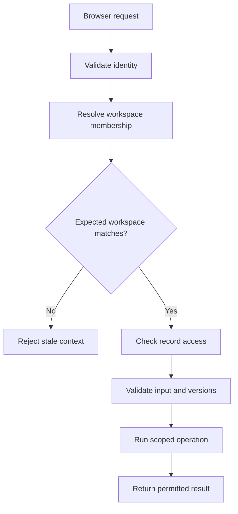
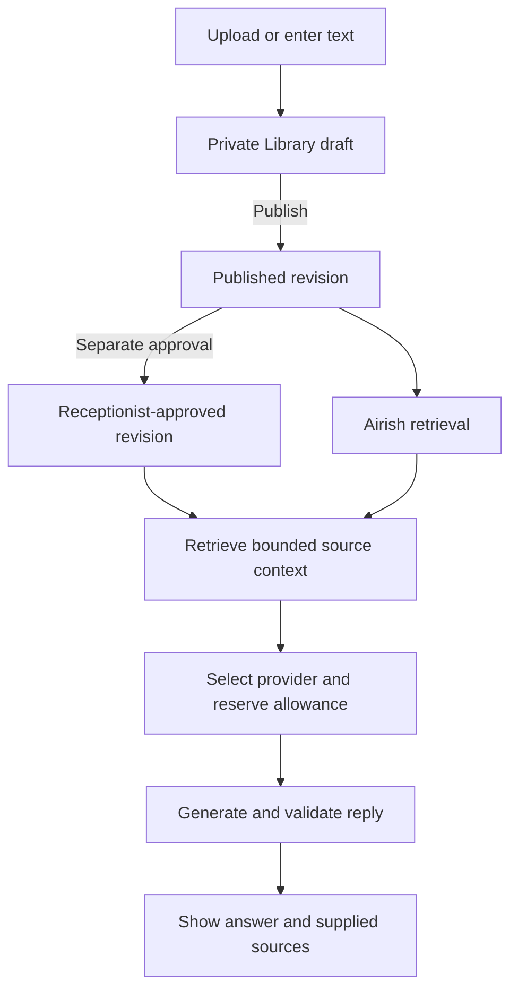
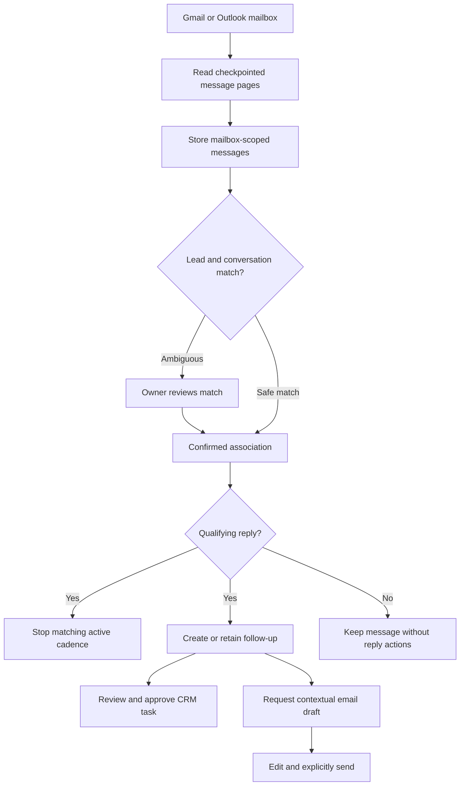
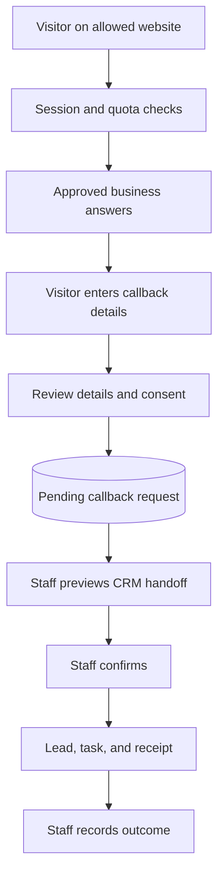

# Follow data through Flowrish

These diagrams show the main checks and data movement. They omit individual fields and some implementation steps. The [architecture guide](ARCHITECTURE.md) explains component boundaries; each feature guide defines its full rules.

## A workspace request

Client-supplied workspace and account headers are expectations to compare, not permission grants. Reads and writes can both fail after access changes. An older successful response must not restore private data that a newer access denial removed.

Read [business switching](workspace-switcher.md) and [follow-up access](follow-up-access.md). Source: [session resolution](../src/server/auth/session.ts) and [service access rules](../src/server/services/access.ts).

## Business knowledge and AI answers

| State | Airish | Receptionist callers |
|-------|--------|----------------------|
| Draft only | Excluded | Excluded |
| Published | Available within current access | Excluded until approved |
| Current published revision approved for reception | Available | Available to that business's receptionist |
| Unpublished or archived | Excluded on the next retrieval | Excluded on the next retrieval |

Editing a draft leaves the old publication intact. Publishing again changes the live revision and clears its receptionist approval. Revocation affects later retrievals; it cannot recall an answer already generated or spoken.

Sources show what was supplied to the model. They do not prove every statement in its answer. Chart validation checks a bounded data format, not the truth of the business figures.

See [business knowledge](BUSINESS_KNOWLEDGE.md), [Airish](AIRISH.md), and [provider settings](AI_PROVIDER_SETTINGS.md). Source: [retrieval](../src/server/services/knowledge.ts), [AI service](../src/server/services/ai.ts), and [provider reservations](../src/server/services/org-ai-provider.ts).

## Email replies and follow-ups

Automatic replies, delivery failures, outbound messages, and unsafe matches must not stop a cadence as though they were a prospect's reply. Merged lead addresses are routing evidence, not new email-provider aliases.

Task approval and email sending are separate. A send checks current access, outreach restrictions, mailbox ownership, recipient, and source/draft versions. Once the provider may have accepted a request, an uncertain result blocks a blind resend.

See [mailbox sync](AUTOMATIC_MAILBOX_SYNC.md), [merge-aware replies](merge-aware-replies.md), [follow-up inbox](FOLLOW_UP_INBOX.md), [conversation drafts](CONVERSATION_DRAFTS.md), and [send recovery](ops/send-result-recovery.md).

## Website callbacks and CRM handoff

Saving the visitor's request does not create a CRM lead or task, reserve an appointment, place a call, or send email. Staff must confirm the handoff. A requested time must fit the saved business calendar and still needs staff confirmation.

This is the website flow. A configured phone receptionist uses a different contract: the caller's confirmation can create the lead/activity/task together. Browser preview produces a summary without that CRM write, and Demo mode keeps its simulated work in page memory.

See [website reception](WEBSITE_RECEPTIONIST.md), [phone reception](AI_RECEPTIONIST.md), and [browser testing](RECEPTIONIST_PREVIEW.md).

## Related guides

[Architecture](ARCHITECTURE.md) · [User guide](USER_MANUAL.md) · [Testing](TESTING.md) · [Documentation index](README.md)
