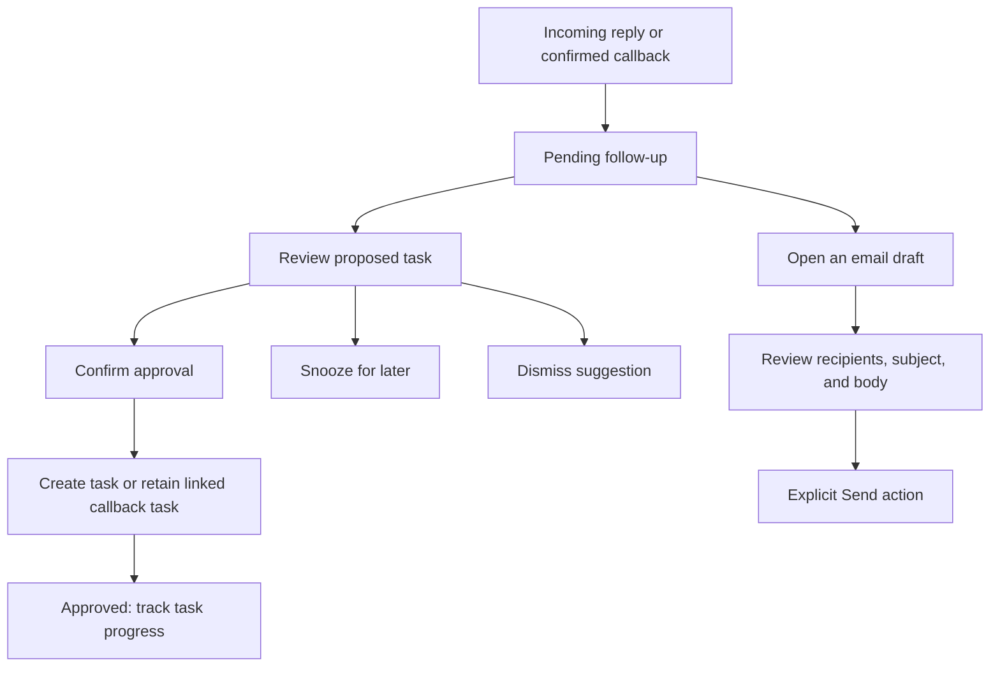

# Review work in the follow-up inbox

Open **Follow-ups** in the sidebar to review incoming replies and receptionist callbacks. A card shows the source, proposed task, and available actions. Reviewing a task and sending an email are separate decisions.

## Choose the work to review

| Tab | What it contains |
|-----|------------------|
| Pending | Suggestions waiting for approval or dismissal |
| Snoozed | Suggestions deferred until a chosen time |
| Approved | Approved suggestions and their linked task progress |
| Dismissed | Suggestions you dismissed, with history retained |

Use search and source filters to narrow the list. Approved also supports task-progress filters for open, overdue, and completed tasks. The overdue indicator opens Approved with the overdue filter. Private saved views retain the supported filters for the current user and workspace across devices.

**Load more** reads the next page with the same filters. It keeps open drafts and edits. Callback catch-up is separate: **Continue catch-up** processes another bounded batch of eligible older callbacks and reports progress. Neither control sends an email.

Read [search recovery](ops/follow-up-search-recovery.md), [saved views](ops/saved-follow-up-views-recovery.md), and [large-inbox behavior](ops/inbox-performance.md) for the detailed rules.

## Review before changing work

Approval creates a task once. If a callback already has a task, approval retains it. Approving several items uses the same reviewed process, with a separate result for each item.

In Approved, review and confirm task completion or deadline changes before applying them. Bulk actions show the selected work and return individual results. Keep successful results when another item fails. An uncertain result needs reconciliation before another write.

Snoozes create in-app reminders. They do not schedule an email. Dismissal does not delete the lead or recall previous actions.

| Action | Result | Detailed guide |
|--------|--------|----------------|
| Approve | Create or retain the reviewed task | [Approval recovery](ops/bulk-follow-up-approval-recovery.md) |
| Snooze | Defer review and create a reminder | [Snooze recovery](ops/follow-up-snooze-recovery.md) |
| Complete task | Record the reviewed task completion | [Completion](ops/approved-task-completion-recovery.md) |
| Change deadline | Reschedule the linked task | [Rescheduling](ops/approved-task-reschedule-recovery.md) |
| Open history | Read recorded follow-up activity | [History filters and recovery](ops/follow-up-history-recovery.md) |
| Generate contextual draft | Ask the configured AI provider for text | [Conversation drafts](CONVERSATION_DRAFTS.md) |
| Send | Submit the reviewed email through the connected mailbox | [Send-result recovery](ops/send-result-recovery.md) |

## Keep drafts and uncertain results

The composer can save draft text privately for the current user, workspace, and source. Wait for the saved confirmation before relying on restoration elsewhere. Failed or offline saves remain unsaved; reconnecting does not automatically replay writes. Attachments remain local to the open composer.

Compact cards and controls retain edits when collapsed. A failed read or page load must not replace a valid unsent draft. Access revocation can remove private content, so keep a permitted copy before intentionally changing accounts or permissions.

| Situation | What to do |
|-----------|------------|
| Inbox is offline or stale | Reconnect, then refresh the read; inspect existing edits before acting |
| Draft has a newer saved revision | Review the restore/conflict choice; do not overwrite it blindly |
| Task action has no confirmed receipt | Check its result before repeating the action |
| Send outcome is uncertain | Use the explicit status check; retries stay blocked while delivery is unresolved |
| Some bulk items succeeded | Keep those results and review only the remaining items |
| Server capabilities changed between pages | Retry the read; preserve existing drafts during the recoverable error |

**Needs checking** identifies send outcomes that need attention. A status check does not send another email. Check freshness before relying on an older result. Provider acceptance and inbox delivery are different facts; Flowrish cannot promise exactly-once delivery across a lost provider response.

See [draft storage](ops/saved-compose-drafts.md), [offline recovery](ops/inbox-freshness.md), and [send status](ops/follow-up-send-status.md).

## Understand incoming sources

Mailbox sync reads Gmail or Outlook using mailbox-scoped identities. A qualifying inbound reply stops a matching active cadence. Outbound mail, automatic replies, delivery failures, and ambiguous lead/thread matches must not stop one.

After a lead merge, archived addresses can route replies to the surviving lead. Ambiguity requires review by the mailbox owner. A source preview is not the full conversation. **Generate contextual draft** retrieves the permitted source conversation before requesting a draft; generation never sends it.

Automatic sync checks run every five minutes when Inngest is configured. The first sync covers the past day; later syncs continue from the last successful checkpoint with overlap. A reply cannot recall an email the provider already accepted.

Read [mailbox sync](AUTOMATIC_MAILBOX_SYNC.md), [reply matching](merge-aware-replies.md), and [the email data flow](DATA_FLOWS.md#email-replies-and-follow-ups).

## Access and recovery

Inbox access requires lead-read permission. Approval and dismissal require lead-write permission. Other actions also recheck their task, mailbox, source, and ownership rules. Items belong to the current workspace and authorized assignee; a public receptionist cannot read this inbox.

Use the [testing guide](TESTING.md) for mocked browser coverage and isolated database checks. The [operations index](ops/README.md#follow-up-inbox) links each recovery procedure.

On rollback, keep additive inbox storage and history. Reverting application code does not undo approved tasks, completed actions, sent emails, or cadence exits. Keep the partial unique index for live cadence enrollments; restoring the old full-status index can fail after repeat historical exits exist. Do not drop inbox tables, edit applied migrations, or reactivate cadences automatically.

[User guide](USER_MANUAL.md) · [Access rules](follow-up-access.md) · [Documentation index](README.md)
