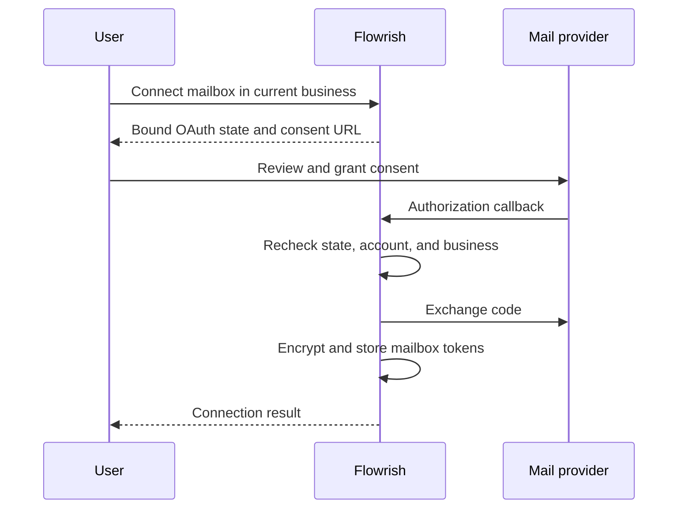

# Connect Flowrish to other services

Deployment operators configure shared service applications. Workspace administrators configure business-owned AI and voice accounts. Each teammate connects their own mailbox.

| Integration | Deployment setup | Workspace or user setup |
|-------------|------------------|-------------------------|
| Supabase | Auth, database, storage, and server credentials | Membership and role assignments |
| Google mail | OAuth application and allowed URLs | Each user connects Gmail |
| Microsoft mail | Optional OAuth application and allowed URLs | Each user connects Outlook |
| AI | Optional deployment fallback | Administrator saves organization provider, model, key, and limits |
| Voice | No shared telephony credentials required by the app | Administrator configures that business's Twilio account |
| Background jobs | Inngest keys and registered endpoint | Job eligibility follows current settings and access |
| CSV import | No external CRM API connector | User exports and reviews CSV data |

Start with [setup](SETUP_GUIDE.md). This guide covers the connection boundaries, not current vendor prices or account eligibility.

## Connect a mailbox

App sign-in and mailbox authorization are separate. Use **Settings** to connect Gmail or Outlook in the intended business. Finish the consent flow in the same signed-in account and workspace where it began. Switching business invalidates that attempt.

| Provider | Deployment configuration | Requested mail access |
|----------|--------------------------|-----------------------|
| Gmail | Google client ID/secret, public client ID, authorized app origin, and `/api/email/callback` | Gmail send and read-only scopes |
| Outlook | Microsoft client ID/secret, public client ID, and `/api/email/microsoft/callback` | `offline_access`, `openid`, `profile`, `User.Read`, `Mail.Read`, `Mail.Send` |

The source lists the exact scopes: [Gmail connection](../src/components/email/gmail-connect.tsx) and [Microsoft adapter](../src/server/services/microsoft-email.ts). Configure provider consent according to the account and tenant policies for your installation. Flowrish's requested scopes do not guarantee an account will be allowed to connect.

Mail sync stores mailbox-scoped message identities and related activity. A safe inbound reply can stop a matching cadence and create follow-up work. Ambiguous matches need owner review. Sync health and checkpoints are described in [automatic mailbox sync](AUTOMATIC_MAILBOX_SYNC.md).

Manual follow-up emails require an explicit Send action. Cadences can send their configured steps after activation and enrollment. Neither provider can recall a message already accepted merely because Flowrish later loses access or rolls back code.

See [conversation drafts](CONVERSATION_DRAFTS.md), [merge-aware replies](merge-aware-replies.md), and [send recovery](ops/send-result-recovery.md).

## Configure AI for a business

Open **Settings → AI provider** as an administrator. Choose a supported organization provider, enter a model available to that provider account, save its key, and set usage limits.

Managed organization settings support OpenAI, Gemini, and DeepSeek. Deployment fallback settings can select presets or an OpenAI-compatible endpoint. A preset name is not proof that every provider/model combination works; verify the actual endpoint and model with an explicitly authorized check.

| Action | Provider request? |
|--------|-------------------|
| Save or pause AI settings | No |
| Explicit connection test | Yes; counts against allowance |
| Ask Airish or generate an AI draft | Yes, when the feature reaches generation |
| Scripted Demo mode | No |
| Regular receptionist browser conversation | Can call the configured provider |
| Confirm a completed browser callback readback | Deterministic; no additional generation |

Keys stay on the server. A configured but paused, invalid, or exhausted organization provider fails visibly instead of silently spending a shared fallback key. Public website reception requires the organization's own configuration.

Read [provider settings and reservations](AI_PROVIDER_SETTINGS.md), [Airish](AIRISH.md), and [business knowledge](BUSINESS_KNOWLEDGE.md). Application token reservations are not a currency billing cap.

## Configure calling

| Mode | What it does | Requirements |
|------|--------------|--------------|
| Device dialer | Opens a `tel:` link; the rep logs the call | A compatible device or softphone; carrier charges can still apply |
| Browser calling | Uses the business's Twilio credentials for an outbound call | Configured voice account and browser audio permission |
| Phone receptionist | Answers the configured incoming Twilio number | Business settings, callback owner/stage, approved information, Auth Token, routing, and explicit activation |

Other voice-provider cards store preferences and setup information; they are not interchangeable working browser-call adapters.

For Twilio browser calling, configure the Account SID, caller ID, API key SID/secret, and TwiML App in **Settings → Calling & voice**. Its outgoing Voice Request URL is the app's `/api/voice/twiml` endpoint. Include the Auth Token so the outgoing webhook can verify Twilio signatures. The legacy outbound route permits setup without it and cannot verify those requests.

Incoming receptionist routing uses a separate `/api/voice/receptionist/ORGANIZATION_ID` endpoint. Enabling it requires the Auth Token and business callback references. Incoming requests validate the Twilio signature, account, and destination before generating an answer.

A browser transcript, read-aloud reply, or mocked webhook test is not a successful telephone call. Use the [phone guide](AI_RECEPTIONIST.md) for explicit activation and real-call verification. Website reception has its own [setup guide](WEBSITE_RECEPTIONIST.md) and switch.

## Import data from another CRM

CSV import is a reviewed data transfer, not a live two-way integration.

1. Export the supported records from the source CRM.
2. Open Flowrish's import/export page.
3. Review the detected columns and field mapping.
4. Check the preview and duplicate/error results before using the imported records.

The importer can create related company/contact records according to mapped fields. Do not assume that an import recreates source-system permissions, attachments, workflows, or provider credentials. Keep exported customer files out of Git and public artifacts.

## Know where credentials live

| Credential | Storage and scope | Protection |
|------------|-------------------|------------|
| Supabase, Redis, Inngest, deployment OAuth secrets | Hosting/local private configuration | Server-only secret handling |
| Gmail/Outlook access and refresh tokens | `EmailAccount`, per connected user and business | AES-256-CBC helper |
| Twilio API secret and Auth Token | `VoiceConfig`, per business | AES-256-CBC helper |
| Organization AI key | `AiProviderConfig`, per business/provider | AES-256-GCM with organization/provider binding |
| Saved follow-up draft text | Private per-user/workspace/source record | AES-256-GCM with context and revision binding |

The encryption formats depend on `EMAIL_ENCRYPTION_KEY`. Rotating or losing it can make retained ciphertext unusable. Plan migration or reconnection before changing it. A database restore alone does not restore external accounts, attachment bytes, or the encryption key.

## Related guides

[Setup](SETUP_GUIDE.md) · [Architecture](ARCHITECTURE.md) · [Data flows](DATA_FLOWS.md) · [Testing](TESTING.md) · [Recovery](ops/README.md) · [Documentation index](README.md)
