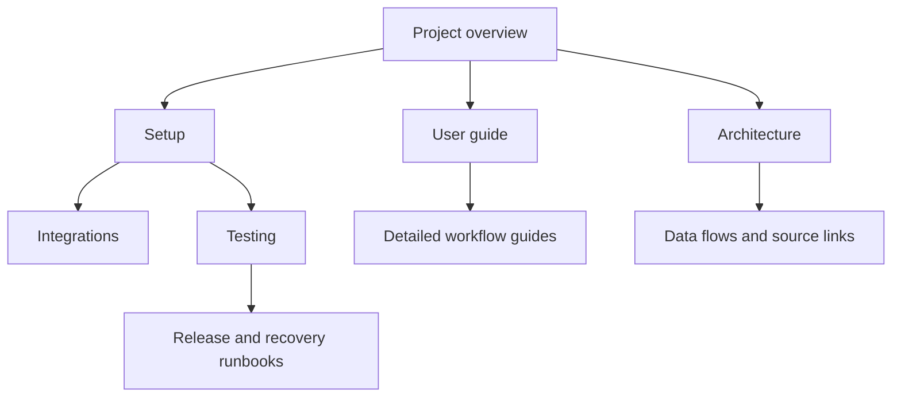

# Flowrish documentation

Choose a guide by what you need to do. The main guides introduce the app; the linked feature guides explain its detailed rules.

## Start here

| Your goal | Main guide | Read next |
|-----------|------------|-----------|
| Understand what Flowrish does | [Project overview](../README.md) | [User guide](USER_MANUAL.md) |
| Run an installation you control | [Setup](SETUP_GUIDE.md) | [Integrations](INTEGRATIONS.md), [testing](TESTING.md) |
| Use the CRM | [User guide](USER_MANUAL.md) | The workflow guides below |
| Understand or change the code | [Architecture](ARCHITECTURE.md) | [Data flows](DATA_FLOWS.md), [contributing](../CONTRIBUTING.md) |
| Connect mail, AI, or calling | [Integrations](INTEGRATIONS.md) | [AI provider settings](AI_PROVIDER_SETTINGS.md) |
| Release or recover an installation | [Operations index](ops/README.md) | The runbook for the affected feature |

## Sales workflows

| Topic | Guide |
|-------|-------|
| Review incoming replies and callbacks | [Follow-up inbox](FOLLOW_UP_INBOX.md) |
| Draft a reply from its email conversation | [Conversation drafts](CONVERSATION_DRAFTS.md) |
| Preserve unsent text and check uncertain delivery | [Saved drafts](ops/saved-compose-drafts.md), [send recovery](ops/send-result-recovery.md) |
| Save personal lead filters across devices | [Saved lead views](SAVED_LEAD_VIEWS.md) |
| Review bulk owner or status changes | [Bulk lead updates](bulk-lead-updates.md) |
| Review and merge duplicate prospects | [Lead merges](safe-lead-merges.md) |
| Resolve replies involving merged addresses | [Merge-aware replies](merge-aware-replies.md) |
| Block email outreach to an address | [Do-not-contact controls](contact-preferences.md) |
| Switch businesses or recover stale access | [Business switching](workspace-switcher.md), [follow-up access](follow-up-access.md) |
| Review mailbox health and attention alerts | [Mailbox sync](AUTOMATIC_MAILBOX_SYNC.md), [email notifications](email-notifications.md) |

## AI and receptionist workflows

| Topic | Guide |
|-------|-------|
| Chat with Airish and review proposed actions | [Airish](AIRISH.md) |
| Configure an organization's model, key, and allowance | [AI provider settings](AI_PROVIDER_SETTINGS.md) |
| Publish services, pricing, and FAQs | [Business knowledge](BUSINESS_KNOWLEDGE.md) |
| Test saved receptionist settings with typing or dictation | [Browser preview](RECEPTIONIST_PREVIEW.md) |
| Configure a business website and review callbacks | [Website receptionist](WEBSITE_RECEPTIONIST.md) |
| Connect an incoming phone number | [Phone receptionist](AI_RECEPTIONIST.md) |
| Review prospects and private pilot access | [Staff waitlist](STAFF_WAITLIST.md), [pilot onboarding](approved-pilot-onboarding.md) |

Website and phone reception require separate activation. Demo mode is scripted. Browser preview can call the configured AI provider but creates no CRM work. See [which mode to use](USER_MANUAL.md#choose-a-receptionist-test-mode).

## Contributor and operator references

| Topic | Reference |
|-------|-----------|
| Development rules and checks | [Contributing](../CONTRIBUTING.md), [repository instructions](../AGENTS.md), [testing](TESTING.md) |
| Dependency updates and known tooling limits | [Dependency maintenance](DEPENDENCY_MAINTENANCE.md) |
| Runtime requests, stored data, and approvals | [Architecture](ARCHITECTURE.md), [data flows](DATA_FLOWS.md) |
| Release gates and feature recovery | [Operations index](ops/README.md) |
| Public-source boundaries | [Release policy](OPEN_SOURCE_READINESS.md) |
| Vulnerability reporting and credentials | [Security policy](../SECURITY.md) |
| Licensing and attribution | [MIT license](../LICENSE), [third-party notices](../THIRD_PARTY_NOTICES.md) |
| Dated product research | [Receptionist comparison](RECEPTIONIST_COMPETITORS.md); check its research date before relying on vendor claims |

Internal specifications, implementation plans, personal editor state, and private operational evidence are kept outside this repository. The public guides describe application behavior, not the configuration or customer data of the hosted installation.
