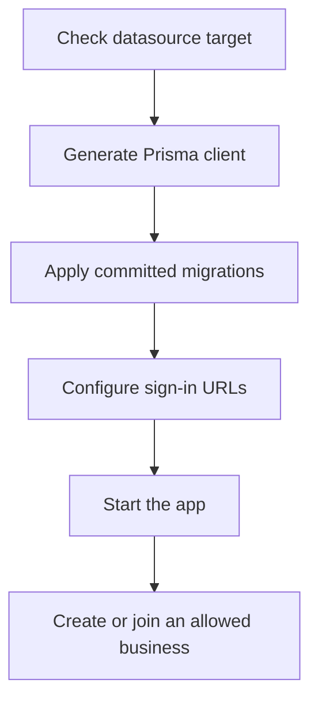

# Run your own Flowrish installation

This guide starts a development installation using services you control. Use synthetic data while setting it up. The hosted Flowrish application and its credentials are not part of the source license.

For the system design, read [architecture](ARCHITECTURE.md). For everyday use, read the [user guide](USER_MANUAL.md).

## Prepare the services

Use Node.js 22, npm, and Git.

| Service | Purpose | Configuration |
|---------|---------|---------------|
| Supabase Auth | Sign-in and user identity | Project URL, publishable key, server secret |
| PostgreSQL | CRM records and application settings | Runtime and migration connections |
| Upstash Redis | Rate limiting | REST URL and token |
| Inngest | Durable and scheduled jobs | Event/signing keys and registered app endpoint |
| Google OAuth application | Google login and Gmail connection | Deployment OAuth credentials and allowed URLs |
| Microsoft OAuth application | Optional Outlook connection | Deployment credentials and redirect URL |
| AI provider | Optional AI features | Organization settings or deployment fallback |
| Twilio | Optional browser/phone calling | Per-workspace settings, not shared deployment keys |

The runtime schema currently requires Supabase, database, Redis, Inngest, Google, and encryption variables to be present. An unused feature does not make its required schema fields optional. Synthetic placeholders belong only in isolated verification; they do not connect a service.

The authoritative required/optional list is [`env.schema.ts`](../src/lib/env.schema.ts). Microsoft and AI configuration are described in [integrations](INTEGRATIONS.md).

## Install the source

```sh
git clone https://github.com/marckengland/flowrish-next.git
cd flowrish-next
npm ci
cp .env.example .env
```

Edit the private `.env` file with your own development configuration. Do not commit it or use the hosted Flowrish database.

| Variable group | Variables |
|----------------|-----------|
| Supabase | `NEXT_PUBLIC_SUPABASE_URL`, `NEXT_PUBLIC_SUPABASE_PUBLISHABLE_KEY`, `SUPABASE_SECRET_KEY` |
| Database | `DATABASE_URL`, `DIRECT_URL` |
| Redis | `UPSTASH_REDIS_REST_URL`, `UPSTASH_REDIS_REST_TOKEN` |
| Background jobs | `INNGEST_EVENT_KEY`, `INNGEST_SIGNING_KEY` |
| Google OAuth | `GOOGLE_CLIENT_ID`, `GOOGLE_CLIENT_SECRET`; Gmail also needs `NEXT_PUBLIC_GOOGLE_CLIENT_ID` |
| Encryption | `EMAIL_ENCRYPTION_KEY`: 32 random bytes encoded as 64 hexadecimal characters |
| Public URLs | Set `NEXT_PUBLIC_SITE_URL` and `NEXT_PUBLIC_APP_URL` for your installation |
| Optional Outlook | `MICROSOFT_CLIENT_ID`, `MICROSOFT_CLIENT_SECRET`, `NEXT_PUBLIC_MICROSOFT_CLIENT_ID` |

Variables prefixed with `NEXT_PUBLIC_` can reach the browser. Do not put a secret in one. Keep the encryption key in a protected secret store; encrypted rows need the same key after recovery.

No deployment-wide AI key is required when an organization supplies its own key through Settings.

## Prepare the database



Use the connection details from your own project. A Supabase transaction pooler commonly uses port 6543 with `pgbouncer=true` for runtime queries; migrations need the appropriate direct/session connection, commonly port 5432. Match the connection type, TLS requirements, and URL-encoded password to your project.

**Check `.env` before running Prisma.** [`prisma.config.ts`](../prisma.config.ts) loads it with override enabled. Shell datasource variables do not override that file.

```sh
npx prisma generate
npx prisma migrate deploy
```

Apply the committed migration history to a new installation. Do not create another initialization or email-thread migration just to start the app. For an upgrade, review pending migrations and compatibility requirements before deploying code.

Disposable database tests use a different procedure in [repository instructions](../AGENTS.md): copy the schema, use explicit loopback-only dummy configuration, generate SQL offline, and apply it inside the owned container. Never run `prisma db push` from this checkout for test setup.

## Configure sign-in URLs

Use the origin where your installation runs, such as `http://localhost:3000` during development. Configure the matching hosted origin before a production deployment.

| Setting | URL or origin to allow |
|---------|------------------------|
| Supabase Auth site URL | Your app's origin |
| Supabase Auth redirect allowlist | `/auth/confirm` for magic links and `/auth/callback` for Google sign-in, on that origin |
| Google sign-in provider | The Supabase callback URL supplied by your project |
| Gmail OAuth app | Your app's authorized JavaScript origin and `/api/email/callback` redirect |
| Outlook OAuth app | Your app's `/api/email/microsoft/callback` redirect |

Enable the authentication providers you intend to use. App sign-in and mailbox connection are separate flows; a Google sign-in does not automatically connect Gmail. See [email connections](INTEGRATIONS.md#connect-a-mailbox).

Configure the Supabase **Magic link** email template to send the token hash to Flowrish's confirmation handler:

```html
<a href="{{ .RedirectTo }}?token_hash={{ .TokenHash }}&amp;type=magiclink">Sign in to Flowrish</a>
```

The login form supplies `/auth/confirm` as `RedirectTo`, without a query string. That handler requires `token_hash` and `type=magiclink`; a bare redirect fails with `invalid_link`. Preserve the fixed app callback and its redirect allowlist. For hosted Supabase, edit the template in its dashboard. Local or self-hosted Supabase uses its own template configuration. See [Supabase's template variables and configuration](https://supabase.com/docs/guides/auth/auth-email-templates).

## Start the app

```sh
npm run dev
```

Open `http://localhost:3000`. The public landing page is `/`; the authenticated app is `/dashboard`. Registration policy determines whether a new user can create a workspace or needs an approved invitation.

You can also use `bash start.sh` on macOS/Linux or `start.bat` in Windows Command Prompt:

| Startup step | Behavior |
|--------------|----------|
| Check Node | Requires major version 22 |
| Find configuration | Creates `.env` from the example and stops when it is missing |
| Install | Uses `npm ci` when `node_modules` is absent |
| Generate and migrate | Runs both against this checkout's configuration |
| Handle a failure | Stops instead of starting with a failed setup |
| Launch | Runs the development server |

The helpers apply migrations. They are not service-free smoke tests.

## Connect the optional workflows

| Workflow | Next step |
|----------|-----------|
| Background jobs | Register your deployed `/api/inngest` endpoint and check actual function runs |
| Gmail or Outlook | Complete each user's mailbox OAuth connection |
| AI | Save the organization's provider, available model, key, and limits |
| Attachments | Run `npm run setup:storage` against your project to create the private bucket |
| Website receptionist | Save allowed origins and limits, rehearse, then explicitly enable |
| Phone receptionist | Configure Twilio, incoming routing, and the business callback destination |

See [integrations](INTEGRATIONS.md), [provider settings](AI_PROVIDER_SETTINGS.md), [website reception](WEBSITE_RECEPTIONIST.md), and [phone reception](AI_RECEPTIONIST.md). Keep reception disabled while preparing the setup.

## Test with synthetic data

Start with the service-free checks:

```sh
npm run test:startup
npm run test:public-repository
```

Then follow the [testing guide](TESTING.md) for the full checks. It separates mocked browser tests, disposable database drills, and authenticated application E2E. Live provider tests are optional and require separate authorization and a request budget.

If you need demonstration CRM records, the explicit `npm run seed:demo` command targets an organization selected by `SEED_ORG_SLUG` or its supported owner-email selectors. It refuses writes without `SEED_DEMO_CONFIRM=yes`. Use only an installation and organization you control. `npm run seed:demo:clean` removes its tagged demo records and needs the same target and confirmation; it is not a general database reset.

## Deploy an installation

Configure your own hosting project, environment secrets, Auth redirects, and Inngest registration. Apply reviewed migrations before promoting code that needs them. The checked-in [Vercel configuration](../vercel.json) runs `prisma generate && npm run build`, uses region `sin1`, and marks API responses `no-store`. Review those choices for your services.

The maintainer's GitHub pipeline runs validation and gates production on successful tests, startup/public-source checks, and migrations. Public forks skip its production jobs and must provide their own pipeline. Do not remove the target guards to deploy a fork.

See [deployment gates](ops/production-deployment.md), [recovery](ops/production-deployment-rollback.md), and [public-source policy](OPEN_SOURCE_READINESS.md).

## Troubleshooting

| Symptom | Check |
|---------|-------|
| Missing environment variable | Compare your private configuration with `env.schema.ts`; the first server access validates the schema |
| Wrong database target | Inspect the checkout's `.env`; it takes precedence over shell datasource variables |
| Missing table | Check the intended connection and apply existing pending migrations |
| Prepared-statement or pool errors | Check the selected pooler mode and its supported connection parameters |
| OAuth returns to another host | Check site URL, redirect allowlists, and the app's public URL configuration |
| Magic link returns `invalid_link` | Check that its email template supplies `token_hash` and `type=magiclink` to `/auth/confirm` |
| Mailbox connect fails after switching business | Start consent again in the intended business |
| Scheduler configured but no work runs | Check Inngest registration and actual run history |
| Local E2E cannot sign in | Check the synthetic user, Supabase server key, and a valid encryption key |
| AI unavailable | Check saved provider status, allowance, model access, and connection independently |

Return to the [documentation index](README.md), [integrations](INTEGRATIONS.md), or [testing](TESTING.md).
