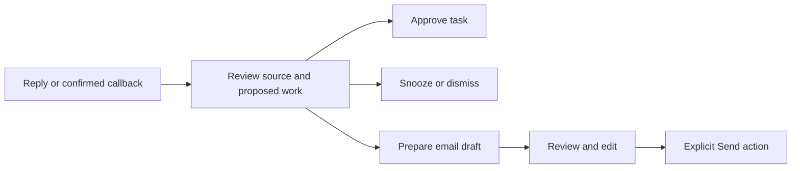

# Use Flowrish

Flowrish keeps sales work inside business workspaces. Your selected business, current role, and connected services determine the records and actions you can use.

For installation, use the [setup guide](SETUP_GUIDE.md). This guide covers daily work and links to detailed workflow instructions.

## Sign in and choose a business

Sign in with a magic link or Google, depending on the installation's configuration. Registration may be closed. Use an approved invitation or pilot link when required.

Select a business from the sidebar. The selection uses your existing membership and does not grant access to another organization. Switching reloads the workspace and clears its cached data, so save edits first. If access changes, use the business recovery chooser.

See [business switching](workspace-switcher.md), [pilot onboarding](approved-pilot-onboarding.md), and [roles and permissions](#roles-and-permissions).

## Find your work

| Area | Use it for |
|------|------------|
| Dashboard | Daily priorities, deal health, gaps, team views, and forecast summaries |
| Leads and Pipeline | Prospect details, stage movement, saved views, and reviewed bulk work |
| Contacts and Companies | Related people and company records |
| Tasks | Assigned work, deadlines, and completion |
| Follow-ups | Review incoming replies and callbacks, prepare tasks, and draft responses |
| Cadences | Configured sequences of email and rep tasks |
| Forecast | Commitments, history, and monthly results |
| Knowledge library | Published business information and receptionist approval |
| Receptionist | Business setup, tests, callbacks, and response performance |
| Settings and Admin | Connections, business configuration, members, roles, and policies |

Some areas require additional permissions or plan entitlement. A missing control can reflect current access, not missing data.

## Manage leads and pipeline work

Create a lead with the required name and stage, then add contact details, company, owner, and deal information. Record calls, meetings, notes, emails, and files on its timeline. The pipeline board moves permitted leads between stages.

| Action | What to review | Detailed guide |
|--------|----------------|----------------|
| Save a lead view | Name and current filters; views belong to your account and business | [Saved lead views](SAVED_LEAD_VIEWS.md) |
| Update selected leads | Exact rows, new owner/status, and confirmation | [Bulk updates](bulk-lead-updates.md) |
| Merge duplicates | Lead to retain, archived fields, transfers, and blockers | [Reviewed merges](safe-lead-merges.md) |
| Block email outreach | Address, reason, and workspace-wide effect | [Do not contact](contact-preferences.md) |
| Import CSV | Field mapping, preview, and duplicate/error results | [Importing data](INTEGRATIONS.md#import-data-from-another-crm) |

Merging archives the secondary lead with its original fields. It does not permanently delete that record or grant a new right to reply from its address. Read the preview before confirming.

Lead deletion and conversion are separate actions. Direct deletion requires its permission; otherwise use the deletion-request workflow when offered. Reassigning a lead does not transfer the old owner's mailbox.

## Review follow-ups

Incoming matched replies and confirmed callback work appear in **Follow-ups**. Use search, source/due filters, and saved views to narrow the inbox.

| Tab | Purpose |
|-----|---------|
| Pending | Work waiting for review |
| Snoozed | Your deferred reviews |
| Approved | Reviewed work and linked task progress |
| Dismissed | Dismissed work, with reviewed restoration where available |

Open a card, review its source, and edit the proposed task. Approval creates a task once or retains an existing callback task. Draft generation and task approval do not send email.

The **Approved** tab can filter open, overdue, and completed tasks. Review before completing or rescheduling work. Bulk actions have their own review and confirmation; check partial results before continuing remaining items.

The **Needs checking** filter identifies unresolved send-status work. It is not permission to resend. Temporary errors preserve authorized drafts and reviews; access loss clears private content.

See the [full inbox guide](FOLLOW_UP_INBOX.md), [saved draft recovery](ops/saved-compose-drafts.md), [activity history](ops/follow-up-history-recovery.md), and [send-result recovery](ops/send-result-recovery.md).

## Email and cadences

Connect your own Gmail or Outlook mailbox in Settings. For a contextual reply, generate a draft from its source conversation, review recipient and text, then send separately. The server rejects stale source/draft bindings instead of silently changing mailbox or thread.

Follow-up text is saved after an editing pause when the recovery service is available. Only an acknowledged save survives reload. Attachments remain in the current tab. Restore offers do not replace current edits automatically or establish whether an email was delivered.

Cadences are different from inbox draft review. Activating a sequence and enrolling a lead authorize its scheduled email/task steps. Those workers recheck status and email restrictions; a qualifying reply or do-not-contact rule can stop matching outreach. An email already accepted by a provider cannot be recalled.

See [integrations](INTEGRATIONS.md), [mailbox sync](AUTOMATIC_MAILBOX_SYNC.md), [conversation drafts](CONVERSATION_DRAFTS.md), and [outreach restrictions](contact-preferences.md).

## Use Airish and business knowledge

Airish can answer questions, draft text, and propose CRM actions. Tables and bar/line charts help with supplied comparisons and trends; they are not proof that a model's numbers are correct.

Leave **Autopilot** off when each proposed action should wait for your confirmation. Turning it on permits supported actions to run without a separate card click. Server access checks still apply. Enrolling a lead in an active cadence can trigger later email steps.

Publish approved business information through the Library. Publication makes a snapshot available to Airish. Public receptionist answers need a separate approval of that published revision.

See [Airish](AIRISH.md), [provider usage limits](AI_PROVIDER_SETTINGS.md), and [business knowledge](BUSINESS_KNOWLEDGE.md).

## Choose a receptionist test mode

| Mode | Uses an AI provider? | What it saves or changes |
|------|----------------------|--------------------------|
| Demo mode | No; prewritten rules | Simulated work stays in page memory |
| Mocked developer rehearsal | No | Synthetic fixture results; no production CRM writes |
| Browser preview | Conversational turns can use configured AI | Preview summary; no CRM callback work. Saving a rehearsal report is separate |
| Enabled website widget | Yes, within configured limits | Visitor-confirmed callback request; staff handoff is separate |
| Enabled phone receptionist | AI plus Twilio | Caller-confirmed callback can create lead, activity, and task |

Set the business name, timezone, hours, callback owner, and stage before activating real reception. Publish and separately approve the public services, pricing, and FAQ documents. Website origins, budgets, and activation are separate from the phone switch.

Callback times are requests, not appointment reservations. Staff confirm timing against the business calendar, including saved date overrides.

See [browser preview](RECEPTIONIST_PREVIEW.md), [website setup and callback review](WEBSITE_RECEPTIONIST.md), and [optional phone setup](AI_RECEPTIONIST.md).

## Roles and permissions

Owner, Admin, Manager, and Member are default roles. Their permissions can be changed, and custom roles are supported. Record visibility and action permissions are checked separately.

| Need | Typical permission |
|------|--------------------|
| Read or edit leads | `leads:read`, `leads:write` |
| Delete a lead or confirm a merge | `leads:delete`, with the workflow's other required permissions |
| Manage cadences | `cadences:manage` |
| Manage members, roles, and teams | `admin:users` |
| Manage business knowledge and integration settings | `admin:settings` |
| Read audit history | `audit:read` |
| Read or submit forecasts | `forecast:read`, `forecast:submit` |

A permission does not grant access to every lead or mailbox. Use the [architecture guide](ARCHITECTURE.md#identity-and-workspace-access) for scope rules and the [permission definitions](../src/types/permissions.ts) for defaults.

## Recover from a problem

| What you see | Next step |
|--------------|-----------|
| Business or account changed | Reload or choose a retained business; do not repeat an old write |
| Temporary read error or offline state | Keep the tab and local edits; use the offered read retry |
| Saved draft conflict | Review the saved and local versions before replacing either |
| Unknown send result | Check status and mailbox evidence; keep retry blocking intact |
| A bulk action finished only some items | Keep completed receipts and review remaining work |
| A stale review | Reload the latest state and prepare a new review |

For operational recovery, use the [operations index](ops/README.md). For testing and limits, use [testing](TESTING.md). Return to the [documentation index](README.md) for feature-specific guides.
